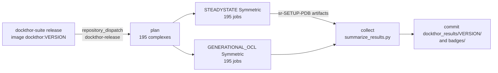

# dockthor_coreset

Redocking qualification set for the [DockThor Suite](https://github.com/gmmsb-lncc/dockthor-suite): 195 protein–ligand complexes, prepared in DockThor's own formats and ready to dock, with the TOML configuration of every complex and the script that runs the whole set and reports the success rates.

It answers one question about a DockThor build or setting: **how often does DockThor find the ligand crystal pose?** Every complex is redocked into its own receptor, and each GA run is a success when its pose is within a given RMSD of the crystal ligand.

- [1. The dataset](#1-the-dataset)
- [2. Repository layout](#2-repository-layout)
- [3. Quick start](#3-quick-start)
- [4. The qualification scripts](#4-the-qualification-scripts)
- [5. Output](#5-output)
- [6. Practical notes](#6-practical-notes)
- [7. Automated qualification of every release](#7-automated-qualification-of-every-release)
- [8. References](#8-references)

---

## 1. The dataset

### 1.1 Origin

The complexes are the **core set of PDBbind v2013**, the test set of the CASF-2013 benchmark (Li et al., 2014): 65 protein targets with 3 complexes each, chosen from the PDBbind refined set to cover a wide range of binding affinities with high-quality crystal structures.

Two checks point to v2013 rather than a later release:

- **Size.** The CASF-2013 core set has exactly 195 complexes. The CASF-2016 core set, used with PDBbind v2016 and v2020 (v2020 introduced no new core set), has 285.
- **Dates.** The newest entries here are 2012 depositions (`4g8m`, `4gid`, `4gqq`, `4djv`) and no ID starts with `5`. CASF-2016 includes complexes deposited from 2013 to 2015.

> In this repository the set is also called *vcoreset*. The PDBbind/CASF files were converted to DockThor topologies; the structures are not modified otherwise.

### 1.2 The ligands are the crystal poses, not the optimized ones

CASF-2013 ships each ligand twice: as deposited (`<pdb>_ligand.mol2` / `.sdf`) and energy-minimized (`<pdb>_ligand_opt.mol2` / `_opt.sdf`). Every topology here was built from the **deposited** one.

Checked against the CASF files: the heavy atoms of 192 of the 195 `<pdb>/ligands/<pdb>_ligand.top` are identical to `<pdb>_ligand.sdf` to the three decimals the files carry, and the other three (`1zea`, `2x97`, `3cyx`) differ by at most 0.26 Å; **none** of the 195 matches `_ligand_opt.sdf`, which moves atoms by up to 3.7 Å (1.8 Å for `1zea`, 3.7 Å for `2x97`, 0.9 Å for `3cyx`). Hydrogens were added during the preparation, so a topology has 3 to 73 atoms more than its CASF file.

This is what makes the success rate mean what it says: DockThor measures RMSD against the coordinates of the input `.top` (§1.4), so the reference is the pose as crystallized, and the rates are comparable with the redocking results published for CASF-2013.

### 1.3 Contents

| | Count | Notes |
|---|---|---|
| Complexes | 195 | Named by PDB ID (`10gs`, `1a30`, ... `4tmn`) |
| Receptors | 195 | DockThor receptor topology (`.in`, the PDBThorBox format) |
| Charged PDBs | 195 | The same receptors as the PDB DockTScore reads, derived from the `.in` (`receptors/prep/`, §1.8) |
| Ligands | 195 | DockThor ligand topology (`.top`, MMFF94S, the MMFFLigand format); 15 to 140 atoms, median 42 |
| Complexes with cofactors | 70 | 239 cofactor topologies, **every one a single metal ion**; 1 to 23 per complex (§1.6). No water, no coenzyme |
| Affinities | 195 | One CSV row per complex: `-logKd/Ki`, ΔG, the published constant, the cluster (`index/affinity.csv`, §1.7) |
| TOMLs | — | **Generated, not committed**: one per complex, from its ligand, in well under a second (`config/<pdb>.toml`, §1.5) |

### 1.4 Files of one complex

Each complex is a directory of the set directory `v2013-coreset/` (§2.1), named after its PDB ID, with one folder
per role: `receptors/`, `ligands/` and, for 70 complexes, `cofactors/`. The paths below are relative to the set
directory:

| File | Contents |
|------|----------|
| `<pdb>/receptors/<pdb>.in` | Receptor topology: one line per atom with index, type, coordinates, bonded neighbors, charge, atom/residue name, chain |
| `<pdb>/receptors/prep/<pdb>_prep.pdb` | The same receptor as the **charged PDB** DockTScore reads (`-p`): occupancy = partial charge, temperature factor = MMFF94S atom type. Written from the `.in` beside it, so the receptor DockTScore scores is the one DockThor docks into (§1.8) |
| `<pdb>/ligands/<pdb>_ligand.top` | Ligand topology in the **crystal pose**: `$TOTAL_ATOMS` (element, index, MMFF type, charge, x y z, atomic number per atom), `$CON` (bonds), `$SELECTED_TORSIONS` (rotatable bonds) and `$NONBONDED_INTERACTIONS` |
| `<pdb>/cofactors/<pdb>_cofactor-NN.top` | Optional (70 complexes): one topology per cofactor, numbered from `-00`, each holding one metal ion — `$TOTAL_ATOMS 1` in the ligand format — with the matching one-record `.pdb` (§1.6) |
| `config/<pdb>.toml` | DockThor configuration of the complex: its inputs and its docking box. **Generated** by `grid_toml_generator.py`, not committed (§1.5) |
| `index/affinity.csv` | Not per complex: one row per complex of all 195 — affinity, ΔG, cluster, protein (§1.7) |

```text
v2013-coreset/3ehy/
├── receptors/
│   ├── 3ehy.in
│   └── prep/
│       └── 3ehy_prep.pdb
├── ligands/
│   └── 3ehy_ligand.top
└── cofactors/
    ├── 3ehy_cofactor-00.pdb
    ├── 3ehy_cofactor-00.top
    ...
    └── 3ehy_cofactor-04.top
```

**One folder per role, for ensemble docking.** The set has one receptor per complex, but `receptors/` may hold
several (conformations of the same protein, an apo structure, ...): DockThor docks the ligand into each of them, each
with the complex's cofactors. The folder names are the ones DockThor knows, so it can be given either the complex
directory or its receptors folder:

```fish
cd v2013-coreset
dockthor --receptor 3ehy           --ligand 3ehy/ligands/3ehy_ligand.top --grid-center -2.3705 -4.416 -6.5845 --grid-size 16.039 16.039 16.039
dockthor --receptor 3ehy/receptors --ligand 3ehy/ligands/3ehy_ligand.top --grid-center -2.3705 -4.416 -6.5845 --grid-size 16.039 16.039 16.039
```

Both dock into every `receptors/*.in` with the cofactors of `cofactors/` (only the `.top` files are read; the `.pdb`
records are there for other tools), and never take `ligands/` or `cofactors/` for receptors. Finding them in both
forms is new after DockThor 2.5.0: an earlier release given the complex directory docks into the cofactors as
receptors, and given `receptors/` finds no cofactors. The TOMLs therefore name the receptor file and
`cofactors-path` explicitly (§1.5), which every release reads the same way.

**No reference copy of the crystal pose.** The reference of the success rate is the ligand topology itself: DockThor
measures the RMSD of each docked pose against the coordinates of the input `.top`, which are the crystal pose (§1.2).
To check DockThor's RMSDs from outside DockThor, as `--symmetric-RMSD` was validated (§6), use CASF's own
`<pdb>_ligand.sdf`, which holds the same heavy-atom positions (checked for all 195 complexes):

```fish
obrms -f $CASF/10gs/10gs_ligand.sdf steadystate/10gs/10gs_ligand_docked.mol2
```

### 1.5 The TOMLs

**The TOMLs are generated, not committed.** A fresh checkout has no `config/`; `scripts/grid_toml_generator.py` writes all 195 from the ligand topologies in well under a second (§4.4), so the box is always the one the current ligands imply and there is nothing to keep in step by hand:

```fish
python3 scripts/grid_toml_generator.py v2013-coreset      # -> v2013-coreset/config/*.toml
```

`.gitignore` therefore holds `*-coreset/config/`. The release qualification generates them too, per complex in `scripts/ci/dock.sh` and for the whole set in the `collect` job (§7.1). Each `config/<pdb>.toml` holds the inputs and the box of one complex, nothing about the docking itself:

```toml
## DockThor qualification set: 1f8b

output-dir="vcoreset_run"
ligand="/home/me/dockthor_coreset/v2013-coreset/1f8b/ligands/1f8b_ligand.top"
receptor="/home/me/dockthor_coreset/v2013-coreset/1f8b/receptors/1f8b.in"
cofactors-path="/home/me/dockthor_coreset/v2013-coreset/1f8b/cofactors"   # only for the 70 complexes with cofactors
grid-size=[16.022,16.022,16.022]
grid-center=[26.464,17.2705,62.4755]
```

- **The input paths are absolute**, written by the generator where it runs, so DockThor finds the topologies from any working directory: `dockthor --config ~/dockthor_coreset/v2013-coreset/config/1f8b.toml`. A TOML therefore belongs to the checkout (or container) it was generated in; generate the TOMLs again after moving the set. `output-dir` stays relative, to the directory DockThor runs in (the set directory with the script, §4.3).
- **The docking setup is not in the TOMLs.** The evolution type, number of runs, success-rate cutoff and the rest are given when the set is run (`--dockthor-args`), so the same TOMLs serve every setup.
- `output-dir` is `vcoreset_run`; the script's `-o` overrides it.
- **The box** is the ligand's bounding box plus 8 Å of padding, made cubic on the longest edge, centered on the middle of that bounding box: 12.988 to 28.585 Å per edge (median 18.814). `scripts/grid_toml_generator.py` writes them (§4.4) and they are reproducible from the ligands alone.
- **No `grid-rstep`**, so DockThor uses its default 0.25 Å. The 13 complexes whose grid then exceeds DockThor's default limit of 1,000,000 points carry `grid-max-points` with the count, under a comment, so they run anyway (§4.4).

### 1.6 The cofactors

70 of the 195 complexes carry cofactors, 239 topologies in all. **Every one is a single metal ion** — `$TOTAL_ATOMS 1` in the ligand format, with a one-record `.pdb` beside it. There is no water and no coenzyme in the set.

| Ion | Topologies | Complexes | MMFF94S type | Charge |
|-----|-----------:|----------:|-------------:|-------:|
| Ca  | 90 | 28 | 96 | +2 |
| Zn  | 50 | 34 | 95 | +2 |
| Mg  | 44 | 11 | 99 | +2 |
| Na  | 27 |  4 | 93 | +1 |
| Mn  | 18 |  3 | **0** | 0 |
| Hg  |  4 |  1 | **0** | 0 |
| Cd  |  4 |  1 | **0** | 0 |
| Ni  |  2 |  1 | **0** | 0 |

A complex has 1 to 23 of them (34 complexes have one, `3vd4` has 23, `3muz` 14).

**How DockThor uses them.** A cofactor is read as part of the receptor (`cofactors-path`, §1.5) and its atoms go into the interaction grid like any receptor atom. The grid has no distance cutoff — every receptor atom contributes to every grid point — so a cofactor acts on the docking whether or not it falls inside the box. Of the 239, 66 are inside the box of their complex (45 of the 70 complexes have at least one inside); the rest are farther out and act only through the long-range electrostatic term.

**They matter.** Redocking `3ehy` (2 Zn, 3 Ca) with one short GA run, with and without `cofactors-path`:

| | Energy (kcal/mol) | of which electrostatic | RMSD to the crystal pose |
|---|---:|---:|---:|
| with the cofactors | −51.841 | −64.335 | **0.556 Å** |
| without | −12.617 | −12.035 | 3.630 Å |

**The 28 ions with type 0 are inert.** Mn, Hg, Cd and Ni have no MMFF94S parameters, so the preparation wrote atom type `0` and charge `0`: DockThor's type 0 is the *ghost* type (`suite/modules/forcefield/forcefield.cppm`), whose pair well depth collapses to zero, so these atoms contribute neither electrostatics nor van der Waals. Redocking `3f80` (6 Mn, all inside the box) with and without its cofactors gives **byte-identical** poses and energies. The six complexes concerned are `1n1m` (Hg), `3ao4` (Cd), `3cj2` (Ni), `3f80`, `3kv2` and `3mfv` (Mn): docking them is docking the bare receptor, which is worth knowing before reading their RMSDs.

**Where they come from.** For 67 of the 70 complexes the cofactors are exactly the metal ions of the CASF-2013 `<pdb>_protein.pdb`, identical in species, count and coordinates to the three decimals of the file — note that CASF writes some of them as `ATOM` records with the element as the residue name rather than as `HETATM`. The remaining three (`1n1m` 4 Hg, `3ao4` 4 Cd, `3cj2` 2 Ni, 10 ions) are not in the CASF protein file at all and were taken from the deposited entry during the preparation. **No ion of a CASF protein file is missing from the set.**

The non-ion `HETATM` of the CASF proteins — the modified residues `CSO`, `SEP`, `TPO`, `PTR`, `LLP`, `PCA` and water — are not cofactors and none is carried here; the receptor preparation drops them, so they are absent from the `.in` as well.

**Docking without them.** `--dockthor-args="--cofactors-path ''"` overrides the TOMLs' `cofactors-path` for a whole run (§4.2).

### 1.7 The index: affinities for the correlations

**This is the only part of the CASF distribution a set keeps.** Everything else — ligand, receptor, cofactors — is regenerated by the facilities (§4.5), but a measured affinity is data, so it is carried.

`index/` holds it as **one CSV**, `affinity.csv`, one row per complex (195 rows, 17 KB), written by the `prepare` step from CASF's own index files and read with the standard `csv` module:

```
complex,resolution_angstrom,year,log_affinity,delta_g_kcal_mol,measurement,value_molar,original,cluster,uniprot,protein
1bcu,2.0,1998,3.28,-4.474,Kd,0.00053,Kd=0.53mM,32,P00734,THROMBIN
```

| Column | Meaning |
|--------|---------|
| `complex` | PDB code, the name the set uses everywhere |
| `resolution_angstrom`, `year` | Of the crystal structure |
| `log_affinity` | CASF's **`-logKd/Ki`**, the value the scoring power correlates against |
| `delta_g_kcal_mol` | ΔG = −1.364 × `log_affinity`, the conversion CASF uses to compare with computed energies |
| `measurement` | `Ki` (130 complexes) or `Kd` (65) |
| `value_molar` | The published constant in mol/L, so the numbers of different units compare directly |
| `original` | The published constant as CASF writes it, e.g. `Kd=0.53mM` |
| `cluster` | **1 to 65**, the three complexes of one target sharing it — the grouping CASF ranks within |
| `uniprot`, `protein` | From CASF's name file; empty when it has no row for the complex |

CASF's two fixed-column files are kept beside it as the provenance of the numbers, byte for byte (28 KB): `2013_core_data.lst` (PDB code, resolution, release year, `-logKd/Ki`, the published Kd/Ki, cluster ID) and `2013_core_name.lst` (PDB code, release year, UniProt ID, protein name). Nothing reads them but the converter.

It is what the correlations need, and the set carries nothing for them that it cannot carry:

- **Scoring power:** `log_affinity` against a predicted score; the 195 complexes span 2.07 to 11.52 log units (median 6.27).
- **Ranking power:** `cluster`, 65 clusters of exactly 3 complexes.

`scripts/coreset/affinity.py` holds the conversion the `prepare` step runs, `convert_casf_index(casf / "index")` then `write_csv`. Every row is checked on conversion — `-log10(value_molar)` must agree with CASF's own `-logKd/Ki` to 0.05, which catches a misread unit or column; all 195 agree. No script reads the CSV yet: it is there for the correlations with the scores (scoring and ranking power, grouped by `cluster`), and any reader needs only Python's `csv.DictReader` or a spreadsheet.

---

### 1.8 The charged PDB: the receptor DockTScore reads

DockThor docks into the `.in` topology; **DockTScore refuses it** and takes its receptor only as a PDB whose
occupancy column is the partial charge and whose temperature factor is the MMFF94S atom type (the DockTScore
manual §11). PDBThorBox writes that file beside the topology, but the two have to stay together: a receptor
prepared again today is not the one prepared in 2019 (the hydrogens move and the atom count changes), so a charged
PDB taken from a fresh preparation would make DockTScore score a *different* receptor than the one docked.

The set therefore keeps the charged PDB **derived from the committed `.in` itself** (`scripts/coreset/charged_pdb.py`),
which carries everything a record needs:

```text
    1504   32  -18.92100   13.93800  -12.22700   1502  0 0 0 0 0  -0.900  OXT TER X 158    1
    index  type  x           y          z        <- bonded ->     charge  name res chain number
```

```text
ATOM   1504  OXT TER X 158     -18.921  13.938 -12.227 -0.90 32.00           O
                                                       ^^^^^ ^^^^^ occupancy = charge, B-factor = MMFF type
```

The conversion reproduces PDBThorBox's own `_prep.pdb` byte for byte for 162 of the 189 receptors it can prepare;
in the other 27 a coordinate differs by 0.001 Å in 45 records out of 1.1 million, because the `.in` keeps five
decimals and a PDB three, and PDBThorBox rounds from its own internal values. **Charges and atom types always
match exactly.** Deriving from the `.in` also covers the six receptors PDBThorBox cannot rebuild (§4.5).

The 195 files are committed (87 MB in all) so a clone can rescore without the CASF download; the rescoring step
writes a missing one on the fly, and `qualify_coreset.py` writes it whenever it installs a receptor.

---

## 2. Repository layout

```
dockthor_coreset/
├── README.md
├── pyproject.toml             Black, Ruff and pytest settings of scripts/ (§4.5)
├── scripts/
│   ├── grid_toml_generator.py a TOML per complex with a box fitted to its ligand (§4.4)
│   ├── qualification_set.py   dock the TOMLs and report the success rates (§4)
│   ├── summarize_results.py   merge reports docked elsewhere, without docking (§4.1 F)
│   ├── rescore_results.py     rescore a finished run with DockTScore (§4.8)
│   ├── qualify_coreset.py     build the whole set from CASF-2013 and dock it (§4.5)
│   ├── coreset/               the library of the scripts (§4.6)
│   ├── tests/                 pytest tests of the scripts (§4.6)
│   └── ci/                    dock.sh (one complex in the release image), missing_reports.sh, badge.py (§7)
├── .github/workflows/         qualification.yml + dock-setup.yml: the release qualification (§7)
├── dockthor_results/          <version>/<setup>_qualification_summary.csv and _success_rate.txt; badges/ (§7)
└── v2013-coreset/             one qualification set (§2.1)
    ├── <pdb>/                 one directory per complex (§1.4), 195 of them:
    │   ├── receptors/         <pdb>.in and prep/<pdb>_prep.pdb, the charged PDB (§1.8)
    │   ├── ligands/           <pdb>_ligand.top, the crystal pose
    │   └── cofactors/         <pdb>_cofactor-NN.{top,pdb}   (70 complexes)
    ├── index/                 affinity.csv: affinities and clusters, + CASF's .lst (§1.7)
    └── config/                generated, not committed: <pdb>.toml (§1.5)
```

### 2.1 One directory per qualification set

A **set directory** holds everything one qualification set is made of — one `<pdb>/` directory per complex (§1.4) and `index/`, plus the generated `config/` — so the repository can carry several side by side. Today there is one, `v2013-coreset/`, the CASF-2013 core set of §1; another set is added as a sibling directory with the same layout, built the same way (§4.5). A complex is a directory holding `ligands/<pdb>_ligand.top` (or MMFFLigand's `ligands/<pdb>_ligand_mmff.cif`); any other directory of the set (`config/`, `index/`, a run's output) is not one.

That directory is the **dataset root** the scripts work against, and the paths inside the TOMLs are relative to it (§4.3), so nothing in a set refers to the repository around it:

```fish
python3 scripts/qualification_set.py --config-dir v2013-coreset/config -o steadystate ...
```

The release qualification picks the set with one value, `SET_DIR` (`.github/workflows/qualification.yml`, honored by `scripts/ci/dock.sh`), so qualifying a different set is a one-line change (§7.1).

Results are written inside the repository, one directory per setup (`steadystate/`, `generational_ocl/`, ...); they are untracked files, not part of the dataset. Only the summaries of each DockThor version are kept, in `dockthor_results/<version>/` (§7).

---

## 3. Quick start

Requirements: Python 3.11+ (standard library only; pytest for the tests, §4.5), git, and a DockThor build from [dockthor-suite](https://github.com/gmmsb-lncc/dockthor-suite) (its `README.md` explains the build; `build/bin/dockthor` for the CPU, `build_ocl/bin/dockthor` for OpenCL). The repository is public; DockThor Suite is private.

```fish
git clone https://github.com/gmmsb-lncc/dockthor_coreset.git
cd dockthor_coreset
set DOCKTHOR ~/dockthor-suite        # your dockthor-suite checkout (bash: DOCKTHOR=~/dockthor-suite)
python3 scripts/grid_toml_generator.py v2013-coreset   # the TOMLs are generated, not committed (§1.5)
```

**SteadyState on the CPU, MPI.** 24 GA runs per complex over 24 MPI processes (one run each), top-10 report and per-run success rates up to 3 Å:

```fish
python3 scripts/qualification_set.py --config-dir v2013-coreset/config -o steadystate \
    --dockthor-path $DOCKTHOR/build/bin/dockthor --mpi --np 24 --skip-done \
    --dockthor-args='--ga-evolution-type STEADYSTATE --ga-nrun 24 --success-rate --success-rate-by-run 3'
```

**GENERATIONAL_OCL on the GPU.** OpenCL build, one process (the GPU packs the 24 runs, so no `--mpi`):

```fish
python3 scripts/qualification_set.py --config-dir v2013-coreset/config -o generational_ocl \
    --dockthor-path $DOCKTHOR/build_ocl/bin/dockthor --skip-done \
    --dockthor-args='--ga-evolution-type GENERATIONAL_OCL --ga-nrun 24 --success-rate --success-rate-by-run 3'
```

Each prints one line per complex and ends with the paths of the summary and the success rates:

```
Dataset root (from the TOMLs): /home/user/dockthor_coreset
[1/195] 10gs: mpirun -n 24 .../dockthor --config .../config/10gs.toml --output-dir steadystate --ga-evolution-type STEADYSTATE --ga-nrun 24 --success-rate --success-rate-by-run 3
    ok in <t>s, log: .../steadystate/10gs/10gs_run.log
...
Ran 195 system(s) in <t>s, 0 failed.
Summary: /home/user/dockthor_coreset/steadystate/qualification_summary.csv (195 complex(es) with a _success_rate.csv)
Success rates: /home/user/dockthor_coreset/steadystate/success_rate.txt
```

`steadystate/qualification_summary.csv` then holds the top-N report of every complex (§5.3), and `steadystate/success_rate.txt` the success rate of the whole set for every topK and RMSD cutoff (§5.4). If the run stops, the same command resumes it: `--skip-done` skips the finished complexes.

**With the scoring too.** Adding `--docktscore-path` rescores the best-scored pose of every complex with DockTScore right after it docks, puts the score and the measured affinity in the summary, and writes `steadystate/scoring_power.txt` (§4.7, §5.5):

```fish
python3 scripts/qualification_set.py --config-dir v2013-coreset/config -o steadystate \
    --dockthor-path $DOCKTHOR/build/bin/dockthor --docktscore-path $DOCKTHOR/build/bin/docktscore \
    --mpi --np 24 --dockthor-args='--ga-nrun 24'
```

---

## 4. The qualification scripts

Three scripts, one per step, in this order:

1. **Generate** the TOMLs: `scripts/grid_toml_generator.py <set>` writes `config/<pdb>.toml` (§4.4).
2. **Dock** them: `scripts/qualification_set.py` runs DockThor on every TOML, saves each complex's console output, and
   after every complex rewrites the summary and the success rates (§5).
3. **Merge** reports docked elsewhere, only when the docking was split up: `scripts/summarize_results.py` (§4.1 F).

The docking setup (evolution type, number of runs, ...) is never written into the TOMLs: it is given at run time with
`--dockthor-args`, so the same TOMLs serve every setup. The dataset can be this repository, any directory with the same
layout, or a git repository the script clones (`--git-url`).

### 4.1 Workflows

**A. Run the generated TOMLs** (the usual case, §3). `--config-dir v2013-coreset/config` takes every `<pdb>.toml` of that set:

```fish
python3 scripts/qualification_set.py --config-dir v2013-coreset/config -o steadystate --dockthor-path $DOCKTHOR/build/bin/dockthor \
    --mpi --np 24 --dockthor-args='--ga-nrun 24 --success-rate --success-rate-by-run 3'
```

**B. A subset.** `--complex` restricts any workflow to some complexes, for a quick check of a build:

```fish
python3 scripts/qualification_set.py --config-dir v2013-coreset/config --complex 1bcu 10gs 1f8b -o check \
    --dockthor-path $DOCKTHOR/build/bin/dockthor --mpi --np 4 --dockthor-args='--ga-nrun 4 --success-rate --success-rate-by-run 2'
```

**C. Dock and rescore in one command.** `--docktscore-path` runs DockTScore on the best-scored pose of every
complex right after it docks, puts the score in the summary and reports the scoring power (§4.7):

```fish
python3 scripts/qualification_set.py v2013-coreset -o scored --dockthor-path $DOCKTHOR/build/bin/dockthor \
    --docktscore-path $DOCKTHOR/build/bin/docktscore --mpi --np 24 --dockthor-args='--ga-nrun 24'
```

**D. Straight from GitHub.** `--git-url` clones the set (into `./dockthor_coreset` by default; an existing clone there is reused) and runs any of the above on the clone; `--git-ref` pins a branch, tag or commit:

```fish
python3 dockthor_coreset/scripts/qualification_set.py --git-url git@github.com:gmmsb-lncc/dockthor_coreset.git \
    --git-ref main --git-subdir v2013-coreset --config-dir config \
    -o steadystate --dockthor-path $DOCKTHOR/build/bin/dockthor --mpi --np 24 \
    --dockthor-args='--ga-nrun 24 --success-rate --success-rate-by-run 3'
```

The script prints the checked-out commit (`Dataset commit: <sha>`), which ties the results to an exact version of the set.

**E. Another set.** Any set directory (§2.1) — one `<pdb>/` per complex with `receptors/`, `ligands/` and optionally `cofactors/`, laid out as in §1.4 — works; generate its TOMLs, then pass it as the first argument (its `config/` is used):

```fish
python3 scripts/grid_toml_generator.py ~/my_set
python3 scripts/qualification_set.py ~/my_set -o results --dockthor-path $DOCKTHOR/build/bin/dockthor \
    --dockthor-args='--ga-nrun 10'
```

**F. Merge reports docked elsewhere.** `scripts/summarize_results.py DIR` builds `qualification_summary.csv` and `success_rate.txt` in one shot from every `<ligand>_docked_success_rate.csv` under `DIR`, flat or in `<pdb>/` folders: the reports of parallel jobs (the release qualification, §7), of several machines, or of a set split by `--complex`. It docks nothing. `--config-dir` counts the complexes against its TOMLs and lists the missing ones, `--summary-csv FILE` writes the summary elsewhere (`success_rate.txt` beside it), and `--rmsd-cutoff` is as below; `--from-summary CSV` instead rebuilds only `success_rate.txt` from an existing summary (§5.4):

```fish
python3 scripts/summarize_results.py gathered_reports --config-dir v2013-coreset/config
# Collected 193 of 195 complex(es) from .../gathered_reports
# [warn] 2 complex(es) without results: 10gs 1bcu
```

### 4.2 Options

Values that start with `-` must use the `=` form: `--dockthor-args='--seed 7'` works, `--dockthor-args '--seed 7'` does not.

**Dataset**

| Option | Default | Description |
|--------|---------|-------------|
| `dataset` (positional) | — | The set directory (§2.1), e.g. `v2013-coreset`. Omit it with `--git-url`, or with `--config-dir` (the root is then inferred from the TOMLs, §4.3) |
| `--complex PDB ...` | all | Only these complexes. Without it: every TOML of `--config-dir` |
| `--git-url URL` | — | Clone the set from a git repository (HTTPS, SSH or a local path) instead of giving `dataset` |
| `--git-ref REF` | default branch | Branch, tag or commit to check out. Branches and tags are cloned shallow (`--depth 1`); a commit needs a full clone, done automatically |
| `--git-subdir PATH` | repository root | Set directory inside the cloned repository — `--git-subdir v2013-coreset` for this one, since the sets live in subfolders (§2.1) |
| `--clone-dir DIR` | `./<repo name>` | Where to clone. An existing clone there is reused as is; a non-empty folder that is not a clone stops the script |
| `--git-update` | off | Fetch `--git-ref` (or the remote default branch) into an existing clone and check it out before running |

**Docking**

| Option | Default | Description |
|--------|---------|-------------|
| `--dockthor-path DOCKTHOR` | — (required) | The `dockthor` binary. Runs every selected TOML, one complex after the other |
| `--config-dir DIR` | `config` | The folder of the TOMLs to run. With `dataset` or `--git-url`, relative to the dataset root; alone, relative to the current directory, and the dataset root is inferred from the TOMLs (§4.3). A missing folder stops the script with a hint to run `grid_toml_generator.py` |
| `-o, --output-dir DIR` | TOML's `output-dir` | Passed to DockThor as `--output-dir`, overriding the TOMLs, so the same TOMLs run into one directory per setup. A relative path is relative to the dataset root |
| `--mpi` | off | Launch DockThor with `mpirun` |
| `--np N` | 4 | MPI processes per complex. DockThor spreads the `ga-nrun` runs over them, so `--np` equal to `ga-nrun` runs them all at once |
| `--mpirun CMD` | `mpirun` | MPI launcher, e.g. `srun` on a SLURM cluster |
| `--mpi-args=ARGS` | — | Extra launcher arguments, e.g. `--mpi-args='--oversubscribe --bind-to none'` |
| `--dockthor-args=ARGS` | — | Extra DockThor command-line options for every complex; they take precedence over the TOMLs |
| `--summary-csv FILE` | §5.3 | Path of the summary CSV; `success_rate.txt` goes next to it |
| `--rmsd-cutoff RMSD` | §5.4 | Largest cutoff of `success_rate.txt`: 0.5, 1.0, ... up to `RMSD` (rounded up to 0.5); default 3.0 |
| `--skip-done` | off | Skip complexes that already have a `*_docked.csv` in `<output-dir>/<pdb>/`: rerun the same command to resume |
| `--stop-on-error` | off | Stop at the first complex whose DockThor call fails (default: report it and go on) |
| `--dry-run` | off | Print the DockThor commands without running them |
| `-v, --verbose` | off | Also print DockThor's output to the terminal (it is always saved to the run log) |

The exit status is non-zero when any complex fails.

**Useful DockThor options for `--dockthor-args`** (the full list is in the DockThor manual, `doc/MANUAL_dmrts.md` §6, or `dockthor --help`):

| Option | Meaning |
|--------|---------|
| `--ga-evolution-type` | `STEADYSTATE` (CPU, default) or `GENERATIONAL_OCL` (GPU, OpenCL build) |
| `--ga-nrun N` | Independent GA runs per complex: the denominator of the success rate. 24 runs give 4.2% steps |
| `--success-rate` | Top-N report: energy and RMSD of the lowest-RMSD pose among the top 1..N leaders of all runs. **Always added by the script**, since the summary and `success_rate.txt` are built from it |
| `--success-rate-top N` | N of the top-N report (default 10); requires `--success-rate` |
| `--success-rate-by-run R` | Per-run success rates at 0.5, 1.0, ... up to `R` Å (rounded up to 0.5); also writes every run's leaders (`--log-every-run`). Kept in each complex's directory, not in the summary |
| `--success-rate-RMSD` | Deprecated: DockThor stops with an error |
| `--symmetric-RMSD` | Symmetry-aware RMSD to the crystal ligand (`RMSD_ref`, so the success rate); the clustering keeps the plain heavy-atom RMSD. More accurate for symmetric ligands (§6) |
| `--symmetric-RMSD-clustering` | Deprecated (DockThor warns): the former `--symmetric-RMSD`, symmetry-aware RMSD for the clustering too; much slower (§6) |
| `--seed N` | RNG seed, for repeating a qualification exactly |
| `--ga-evaluations N`, `--ga-init-evaluations N` | Length of the evolution (lower for quick checks) |
| `--ocl-device-type`, `--ocl-platform-name` | GPU selection for `GENERATIONAL_OCL`; `dockthor --ocl-display-devices` lists the devices |

### 4.3 How paths are resolved

The script always runs DockThor with the **dataset root** as working directory, passing each TOML by its absolute path, so a relative `-o` (and the TOML's `output-dir`) lands in the dataset root. The input paths of the TOMLs are absolute (§1.5), so they do not depend on it. The dataset root is:

| Given | Dataset root | `--config-dir DIR` relative to |
|-------|--------------|-----------------------------|
| `dataset` | `dataset` | the dataset root |
| `--git-url` | the clone (or `--git-subdir` in it) | the dataset root |
| `--config-dir DIR` only | inferred: `DIR` or the first parent of it where the `ligand` and `receptor` of a TOML exist (relative paths) or that holds them (absolute paths): `v2013-coreset/` for `v2013-coreset/config` | the current directory |

With `--config-dir` alone the script prints the root it inferred (`Dataset root (from the TOMLs): ...`) and stops if no such folder exists. Run the examples of this README from the repository root, or give `--config-dir` as an absolute path.

The output directory (`-o` or the TOML's `output-dir`) is relative to the dataset root too: `-o steadystate` writes to `dockthor_coreset/steadystate/`.

### 4.4 A box fitted to each ligand: `grid_toml_generator.py`

`scripts/grid_toml_generator.py` writes a TOML for every ligand topology of a folder, with a docking box computed from the ligand itself. It is what wrote the committed `config/` (§1.5):

- **Center:** the middle of the ligand's bounding box (all atoms, hydrogens included), so every atom is at least half the padding away from each face.
- **Size:** the bounding box's extent on each axis plus `--padding` (default 8 Å, half on each side). With `--box-shape cube` (the default) every edge is the longest one; with `--box-shape ligand` each axis keeps its own. A ligand spanning 10 × 20 × 30 Å gives `[38,38,38]`, or `[18,28,38]` with `--box-shape ligand`.
- **Grid step:** `grid-rstep` is written only when `--rstep` is given; without it the TOML has no `grid-rstep` and DockThor uses its default, 0.25 Å.
- **Grid points:** counted as DockThor does (`dockthor/src/Grid.cpp`): per axis `int(size / rstep) + 1` in float32, the total their product, with `--rstep` or DockThor's default step. A grid over DockThor's default limit of 1,000,000 points gets `grid-max-points` with its count, under a comment, so DockThor runs it:

  ```toml
  # grid points: 1520875 (115 x 115 x 115), over DockThor's default limit 1000000
  grid-max-points=1520875
  ```

- **Values:** float32, as DockThor reads them, each written as the shortest decimal that reads back as the same float32 (`21.274`, `6.1335`).

The complexes are the directories of the set holding their ligand (§2.1), `<complex>/ligands/<complex>_ligand` in a format DockThor reads as a ligand, MMFFLigand's outputs: `.top`, and `_mmff.cif` / `.mmcif` (also gzipped) with their `_mmffligand_atom` types. When a ligand is there in several formats the first of `.top`, `.cif`, `.mmcif`, `.cif.gz`, `.mmcif.gz` is used. Another file named `<complex>_ligand*` (a `.mol2`) is reported on stderr as `Skipped unrecognized <file>`; MMFFLigand's deprecated copies (`new_*`, `*_new.*`) are ignored.

Each `<complex>.toml` has the layout of §1.5: `output-dir` (`--run-dir`, default `vcoreset_run`), `ligand` (the file used), `receptor` (`<complex>/receptors/<complex>.in`), `cofactors-path` (`<complex>/cofactors`) when that folder holds `.top` files, `grid-size`, `grid-center`, and `grid-rstep` only with `--rstep`. The ligand, receptor and cofactors paths are written absolute (symbolic links resolved), so the TOMLs run from anywhere, by hand or with `qualification_set.py --config-dir` (§4.1). An existing TOML is kept unless `--overwrite`; a complex without a receptor gets no TOML and an error (exit status 1).

```fish
python3 scripts/grid_toml_generator.py v2013-coreset                     # every complex, TOMLs in v2013-coreset/config/
python3 scripts/grid_toml_generator.py v2013-coreset --padding 10 --box-shape ligand --complex 1bcu 10gs --output-dir toml_fit --overwrite
python3 scripts/qualification_set.py --config-dir v2013-coreset/config -o fitted --dockthor-path $DOCKTHOR/build/bin/dockthor
```

| Option | Default | Meaning |
|--------|---------|---------|
| `dataset` | `.` | Set root, one `<complex>/` per complex; the TOMLs' paths are written relative to it |
| `--output-dir` | `config` | Where the TOMLs are written, relative to the set root |
| `--run-dir` | `vcoreset_run` | The `output-dir` key of the TOMLs |
| `--padding` | `8.0` | Å added to each edge of the bounding box, half on each side |
| `--box-shape` | `cube` | `cube`: every edge the longest one; `ligand`: each axis its own |
| `--rstep` | not written | Grid step (Å), written as `grid-rstep`; without it DockThor's default 0.25 Å, also used to count the points |
| `--complex` | all | Only these complexes |
| `--overwrite` | off | Overwrite existing TOMLs |

The standard output is one line per complex (bounding box, grid size, grid points, and a warning when the grid is over the limit) and a summary with the smallest, median and largest grid.

Run with the defaults on this set, it reproduces the committed `config/`: 195 cubic boxes of 12.988 to 28.585 Å (median 18.814), no `grid-rstep` (DockThor's default 0.25 Å), `cofactors-path` for the 70 complexes that have cofactors, and 13 boxes over DockThor's point limit, which get `grid-max-points` — `3ag9` (1,520,875), `1jyq`, `1hfs`, `3uri`, `4gid`, `1zea`, `1xd0`, `2d1o`, `3nw9`, `3uex`, `2qbp`, `2yki` and `2qmj` (1,030,301).

### 4.5 Building the set from CASF-2013: `qualify_coreset.py`

`scripts/qualify_coreset.py` builds the whole set from the files [CASF-2013](#8-references) distributes, with the DockThor Suite facilities, and then docks it. It is how the set is regenerated for a new suite version; the committed set was prepared this way in 2019, with the facilities of the time.

```fish
set CASF ~/Downloads/CASF-2013/coreset       # one folder per complex
python3 scripts/qualify_coreset.py $CASF --dataset v2013-coreset --output-dir ~/prepared_v2013 \
    --suite-bin $DOCKTHOR/build/bin --skip-dockthor
python3 scripts/qualify_coreset.py $CASF --dataset v2013-coreset --skip-mmffligand --skip-pdbthorbox --skip-config \
    --dockthor-path $DOCKTHOR/build_ocl/bin/dockthor --dock-output generational_ocl_symmetric \
    --dockthor-args='--ga-evolution-type GENERATIONAL_OCL --ga-nrun 24 --success-rate --success-rate-by-run 3 --symmetric-RMSD'
```

**Two directories, because the facilities write much more than a set carries.** `--dataset` is the set directory (§2.1) and receives only the files the set is made of; `--output-dir` keeps **everything** that was generated, one folder per complex, so a preparation can be inspected or compared later:

```
<output-dir>/3ehy/
├── 3ehy_ligand.mol2            the CASF input, copied (MMFFLigand writes beside its input)
├── 3ehy_ligand.top             -> the set's <pdb>/ligands/
├── 3ehy_ligand_mmff.mol2
├── mmffligand_report.csv
├── 3ehy_protein.pdb            the protein records of the split, what PDBThorBox read
├── 3ehy_protein.in             -> the set's <pdb>/receptors/<pdb>.in
├── 3ehy_protein_prep.pdb       the charged PDB (what DockTScore reads)
├── 3ehy_protein_prep.mol2
├── 3ehy_protein.X              the chain file(s)
├── 3ehy_protein_residues.csv   and _summary.csv, resumo.out
├── cofactors/                  <pdb>_cofactor-NN.{pdb,top,_mmff.mol2}  -> the set's <pdb>/cofactors/
└── logs/                       the console output of every facility call
```

It defaults to `<dataset>_prepared` beside the set. Only the `prepare` stage uses it.

Three stages, all run by default, in this order. Each tool has a `--skip-<tool>` option, so a failed stage is repeated without redoing the others; what a skipped tool would have written is taken from the set as it is. The binaries that will run are checked before anything starts:

| Stage | What runs | Skipped with | Writes into the set |
|-------|-----------|--------------|---------------------|
| `prepare` | MMFFLigand on `<pdb>_ligand.mol2` and on each metal ion | `--skip-mmffligand` | `<pdb>/ligands/<pdb>_ligand.top`, `<pdb>/cofactors/` (`.top` and `.pdb`) |
| | PDBThorBox on the protein records | `--skip-pdbthorbox` | `<pdb>/receptors/<pdb>.in`, and `<pdb>/receptors/prep/<pdb>_prep.pdb` written from it (§1.8) |
| | (both) | both options | `index/affinity.csv`, written once (§1.7) |
| `config` | `grid_toml_generator.py` (§4.4) | `--skip-config` | `config/<pdb>.toml` |
| `dock` | DockThor through `qualification_set.py` (§4.1 A); `--dockthor-path`, default `<--suite-bin>/dockthor` | `--skip-dockthor` | `<--dock-output>/`, `qualification_summary.csv`, `success_rate.txt` |

- **The ligand is the deposited pose**, `<pdb>_ligand.mol2`, never `<pdb>_ligand_opt.mol2` (§1.2).
- **The cofactors are regenerated from the protein file**, so the whole set is reproducible from the public distribution. `--extra-cofactors <set>` copies `<set>/<pdb>/cofactors/` of another set (an earlier preparation) for a complex whose protein file holds no ion, which is how the Hg of `1n1m`, the Cd of `3ao4` and the Ni of `3cj2` are kept (§1.6).
- **Crystal waters are dropped**, as they are in the committed set.
- `--complex PDB ...` restricts every stage to some complexes. `--padding`, `--box-shape` and `--rstep` are passed to the `config` stage; `--overwrite` rebuilds files that exist; `--jobs` prepares several complexes at once.

#### Two quirks of the CASF protein files

Both make PDBThorBox fail, and `prepare` handles them before it runs:

- **NUL bytes in the chain column.** `1hfs`, `2jdu`, `2jdy` and others carry a `0x00` where the chain id belongs; PDBThorBox reads it as an extra, nameless chain. They are replaced with spaces.
- **Metal ions written as `ATOM` records** whose residue name is the element (`ATOM ... ZN   ZN   1`). They have no residue template, so the chain cannot be built. These records are exactly the cofactors of the set, and they are moved out of the receptor into one file each.

A third quirk is MMFFLigand's: it rejects a molecule for which OpenBabel's `OBMol::Has3D()` is false, and for a lone atom that holds whenever one of its three coordinates is exactly `0` — so the calcium of `1f8b`, `1f8c` and `1f8d`, at *x* = *y* = 0, is refused as "not 3D structure". `prepare` retries such an ion with each zero coordinate moved by 0.001 Å, which is the workaround the committed cofactors already carry from 2019.

#### Known limitation: receptors with more than 999 residues

PDBThorBox 2.5.0 writes the residue number of its working prep file as a three-column integer (`FORMAT 30` of the ported `seqpdb.f`, `pdbthorbox/src/builder.cpp`, and `LAST_NUMBER` in `pdbthorbox/src/input.cpp`), then reads that file back. A chain numbered past 999 overflows to `***` and the run stops with *the residue number '***' (columns 23-26) is not a number*.

Six complexes of the core set are numbered to 1023-1045 and cannot be prepared by this version: **`1ps3`, `3d4z`, `3ejr`, `3i3b`, `3muz` and `3vd4`**. Their committed receptors exist because the Fortran `seqpdb.f` of 2019 wrote the same overflowed field but never read it back. The failure is in the receptor stage only — their ligands and TOMLs are produced normally.

### 4.6 The scripts' code

The five scripts are command lines over the package `scripts/coreset/` (standard library only, Python 3.12, the version of the DockThor image the release workflow runs them in):

| Module | Holds |
|--------|-------|
| `tomlfile.py` | TOML literals, the `<pdb>.toml` layout |
| `dataset.py` | The set's layout in one place (`<pdb>/receptors/`, `ligands/`, `cofactors/`), finding the set root of a TOML folder, cloning with `--git-url` |
| `molecules.py` | The ligand topologies DockThor reads and their coordinates |
| `gridbox.py` | The box around a ligand and DockThor's grid-point count, in float32 |
| `docking.py` | Running DockThor on the TOMLs, the logs |
| `summary.py` | `qualification_summary.csv`, `success_rate.txt`, the two modes of `summarize_results.py` |
| `charged_pdb.py` | The charged PDB DockTScore reads, written from a receptor `.in` (§1.8) |
| `scoring.py` | Rescoring the best-scored pose of a complex with every DockTScore model (§4.7) |
| `statistics.py` | Pearson, Spearman, the least-squares fit and the two RMSE of `scoring_power.txt` (§5.5) |
| `prepare.py` | Building the set from CASF-2013: the protein split, the facility calls (§4.5) |
| `affinity.py` | Converts CASF's `.lst` into `index/affinity.csv` (affinities, ΔG, clusters), checking every row (§1.7) |

The tests (`scripts/tests/`, pytest) cover the box and the grid-point count, the ligand readers and the files they skip, the TOML layout, the CASF protein split, and the command lines on a small set. Before a change:

```fish
black scripts; ruff check scripts; python3 -m pytest
```

### 4.7 Rescoring with DockTScore: `--docktscore-path`

DockThor ranks its poses with its own energy, which is not comparable between complexes (a complex with five metal
ions sits tens of kcal/mol below one without). **DockTScore** is the suite's scoring function, and its value is what
a set's *scoring power* is measured with. Given `--docktscore-path`, `qualification_set.py` rescores every complex
in the same run, right after it docks:

1. The **best-scored pose** — the first of `<pdb>_ligand_docked.mol2`, which is the pose CASF's scoring power uses —
   is split out as `<pdb>_top1.mol2`.
2. DockTScore scores it against the charged PDB of the receptor (§1.8) and the complex's `cofactors/*.pdb`
   (it reads a cofactor only as PDB or MOL2, never as a `.top`), with `--report-format csv`.
3. It is scored **once per model** of `--docktscore-models` (`general_dock`, `general2764`, `protease` and `ppi` by
   default). DockTScore names its output after the ligand, so each model scores its own copy of the pose:
   `<pdb>_top1_<model>.mol2` gives `<pdb>_top1_<model>.score` and `<pdb>_top1_<model>_score.csv`.
4. Each `DockTScore` value goes into the summary as a `docktscore_<model>` column, at the full precision of the CSV,
   beside the measured affinity of the complex read from `index/affinity.csv`. The same values are written as one
   row in `<pdb>_scores.csv`, which is what a parallel job hands back (§7.2).
5. `scoring_power.txt` and `scoring_power.csv` are rewritten beside `success_rate.txt` (§5.5).

```fish
python3 scripts/qualification_set.py v2013-coreset --complex 1bcu 3ehy 10gs -o scored \
    --dockthor-path $DOCKTHOR/build/bin/dockthor --docktscore-path $DOCKTHOR/build/bin/docktscore
```

`--docktscore-models` picks the coefficients, in the order they are reported: `general_dock` (fitted for docking
poses), `general2764` (the general set of 2764 complexes), `protease` and `ppi` by default, and `general` and
`kinase` are the other bundled models. Each one scores a pose in about 0.1 s — MSMS runs on the fly and is not the
bottleneck — so the four default models add about 80 s to a 195-complex run. `--docktscore-args` passes anything
else through.

A model fitted on another scale (`protease`, `ppi`) is not comparable to a measured ΔG as a number; its
correlations still are, which is why `scoring_power.txt` reports both the scale-free statistics and the two RMSE
(§5.5).

A complex DockTScore cannot score (no pose, a receptor the charged PDB cannot be written from, a non-zero exit) is
reported as a warning and left without a score; the set goes on, and its row simply has an empty
`docktscore_<model>`. One model failing does not stop the others.

The affinity columns do not need the rescoring: whenever the set has an `index/affinity.csv`, every summary row
carries its complex's `log_affinity` and `delta_g_kcal_mol`.

### 4.8 Rescoring a finished run: `rescore_results.py`

`scripts/rescore_results.py DIR` does the same work on a run that is **already docked**, without docking it again:
a run from before the rescoring existed, one docked with other models, or one docked on another machine. It reads
the poses of every complex of `DIR`, rescores them, and rewrites that folder's `qualification_summary.csv`,
`success_rate.txt`, `scoring_power.txt` and `scoring_power.csv` — keeping every column DockThor reported, since the
rows come from the same `<ligand>_docked_success_rate.csv` files `summarize_results.py` reads.

```fish
# The set is needed for the receptors, the cofactors and the affinities: --dataset, or --config-dir to infer it.
python3 scripts/rescore_results.py steadystate --dataset v2013-coreset \
    --docktscore-path $DOCKTHOR/build/bin/docktscore

# Some complexes, one model, and skipping what is already scored.
python3 scripts/rescore_results.py steadystate --config-dir v2013-coreset/config \
    --docktscore-path $DOCKTHOR/build/bin/docktscore \
    --docktscore-models protease --complex 1bcu 10gs --skip-done
```

`--skip-done` reads the `<pdb>_scores.csv` already on disk, so an interrupted rescoring resumes; without it every
complex is scored again. A complex with no `*_docked.mol2`, or with no success-rate report, is skipped with a
warning. 195 complexes × 4 models take about two minutes.

---

## 5. Output

### 5.1 Directory tree

```
<output-dir>/
├── qualification_summary.csv                    top-N report of every complex (§5.3)
├── success_rate.txt                             success rate of the set per topK/overall and cutoff (§5.4)
├── scoring_power.txt / scoring_power.csv        correlation of each model's score with the affinity (§5.5)
├── 10gs/
│   ├── 10gs_run.log                             console output of the DockThor call
│   ├── 10gs_ligand_docked.csv / .mol2           cluster leaders of all runs, best energy first
│   ├── 10gs_ligand_docked_success_rate.csv      top-N report, one row (--success-rate, always added by the script)
│   ├── 10gs_top1.mol2                           best-scored pose alone, what DockTScore rescores (--docktscore-path)
│   ├── 10gs_top1_<model>.mol2                   the pose as given to one model (DockTScore names its output after it)
│   ├── 10gs_top1_<model>.score / _score.csv     that model's terms, rounded and at full precision
│   ├── 10gs_scores.csv                          one row: the complex and its score per model (§7.2)
│   ├── 10gs_score.log                           console output of every DockTScore call
│   ├── 10gs_ligand_docked_success_rate_by_run.csv   per-run rates, one line per criterion and cutoff (with --success-rate-by-run)
│   └── 10gs_ligand_docked_run_<N>.csv / .mol2   leaders of run N (with --success-rate-by-run or --log-every-run)
├── 1a30/
...
```

Each complex directory is named after its receptor file (the PDB ID). The DockThor files are described in the DockThor manual (`doc/MANUAL_dmrts.md` §10).

### 5.2 Run log

`<output-dir>/<pdb>/<pdb>_run.log` is the console output of the DockThor call: the command line, then stdout and stderr, without the terminal colors. It holds the grid, the evolution progress, the top-N summary and the per-run success-rate table:

```
[DOCKTHOR] Success rate (%) over 24 runs, RMSD <= cutoff.
           |------->   <=RMSD  % by energy    % by RMSD
           |------->     0.50        25.00        25.00
           |------->     1.00        33.33        41.67
           ...
```

### 5.3 Summary CSV

`qualification_summary.csv` is the consolidation of every `<pdb>/<ligand>_docked_success_rate.csv`, the one-row top-N report DockThor writes with `--success-rate`: one row per complex, with DockThor's own columns.

```
complex,execution_time(s),num_top,overall_min_RMSD_E,overall_min_RMSD,docktscore_general_dock,docktscore_general2764,docktscore_protease,docktscore_ppi,log_affinity,delta_g_kcal_mol,top1_E,top1_RMSD,...
1bcu,2.61,100,-4.174,0.467,-7.154044149116295,-7.2891,-19.4471,-8.0132,3.28,-4.474,-4.974,1.519,...
1a30,3.70,100,65.495,1.880,,,,,4.62,-6.302,48.371,3.471,...
```

| Column | Unit | Description |
|--------|------|-------------|
| `complex` | — | PDB ID (DockThor's receptor name) |
| `execution_time(s)` | s | DockThor's wall time up to the report (grids, docking, clustering) |
| `num_top` | — | Number of leaders of the all-runs clustering |
| `overall_min_RMSD_E`, `overall_min_RMSD` | kcal/mol, Å | Energy and RMSD of the leader with the lowest RMSD over all the leaders of the all-runs clustering, not only the top N. Empty for results of DockThor 2.1.0 and earlier |
| `topK_E`, `topK_RMSD` | kcal/mol, Å | Energy and RMSD of the lowest-RMSD pose among the K best-ranked leaders, K = 1 ... N (`--success-rate-top`, 10 by default) |
| `docktscore_<model>` | kcal/mol | DockTScore of the best-scored pose with that model, one column per `--docktscore-models` (§4.7). Empty for a complex that model could not score. The columns come in the order the models are scored in, `general_dock`, `general2764`, `protease`, `ppi` |
| `log_affinity`, `delta_g_kcal_mol` | —, kcal/mol | The **measured** affinity of the complex, from `index/affinity.csv` (§1.7). Present whenever the set has that index |

The script rewrites it, and `success_rate.txt`, after every complex, so an interrupted set keeps what is done. Complexes skipped by `--skip-done` are included from their existing files, so a resumed set still gets the whole consolidation. The script always passes `--success-rate` to DockThor (it is added when `--dockthor-args` lacks it), so every docking that succeeds has its row; a complex that failed has none. When complexes use different N, the columns are the union and missing values are empty. The file goes to the common output directory (`<output-dir>/qualification_summary.csv`), or next to the TOMLs when the complexes write to different directories; `--summary-csv FILE` sets it explicitly.

### 5.4 What the success rates mean

DockThor computes the reports at the end of each docking; the full definition is in the DockThor manual, `doc/MANUAL_dmrts.md` §10.5.

**Top-N (`topK_*`).** The leaders of the clustering of all runs (the poses of `_docked.csv`) are sorted by energy; `topK` is the pose with the lowest RMSD to the crystal ligand among the first K. `top1` is DockThor's answer, and the RMSD can only drop as K grows: the K where it first falls below 2 Å is the rank at which the native pose shows up. When there are fewer than N leaders (`num_top` < N), the last `topK` repeat the best of them all.

**Success rate of the set (`success_rate.txt`).** For every cutoff *c* = 0.5, 1.0, ... up to `--rmsd-cutoff` (rounded up to 0.5) and every `topK`, the share of complexes whose `topK_RMSD <= c`, over the complexes with a `_success_rate.csv`. `top1` at 2 Å is the classic redocking success rate; `top10` at 2 Å, how often the native pose is among the 10 best-ranked poses. The first column, `overall`, is the share whose `overall_min_RMSD <= c`: whether the native pose is among the leaders at all, at any rank. With the 3 complexes above (short runs, `--rmsd-cutoff 2.2`):

```
Success rate (%) of the top-N report (DockThor --success-rate), topK_RMSD <= cutoff
overall: overall_min_RMSD <= cutoff (the lowest-RMSD leader of all the leaders)
Complexes with results: 3 of 3

RMSD_cutoff  overall     top1     top2     top3     top4     top5     top6     top7     top8     top9    top10
        0.5    33.33     0.00    33.33    33.33    33.33    33.33    33.33    33.33    33.33    33.33    33.33
          1    33.33     0.00    33.33    33.33    33.33    33.33    33.33    33.33    33.33    33.33    33.33
        1.5    33.33     0.00    33.33    33.33    33.33    33.33    33.33    33.33    33.33    33.33    33.33
          2    66.67    33.33    33.33    33.33    66.67    66.67    66.67    66.67    66.67    66.67    66.67
        2.5   100.00    33.33    66.67    66.67    66.67    66.67    66.67    66.67    66.67    66.67    66.67
```

`Complexes with results` is the denominator; a failed complex is left out of it, so compare it with the number of complexes run. Each column counts only the complexes that have its value: results of DockThor 2.1.0 and earlier have no `overall_min_RMSD`, so they are left out of `overall` (the column is missing when no complex has it).

**From an existing summary (`summarize_results.py --from-summary`).** When a set was run in pieces (an interrupted run finished by hand, or complexes run on different machines) and the `qualification_summary.csv` files were joined into one, rebuild the success rates from it. `success_rate.txt` is written to the current directory, with the cutoffs of `--rmsd-cutoff`; the denominator is the number of complexes in the CSV:

```fish
cd ~/results/steadystate
python3 ~/dockthor_coreset/scripts/summarize_results.py --from-summary qualification_summary.csv --rmsd-cutoff 2
```

**Per run (`--success-rate-by-run`).** In short, with *N* = `ga-nrun` runs:

1. Each run is clustered on its own, and its leaders are sorted by energy.
2. **By energy:** each run contributes its lowest-energy leader, the pose DockThor would answer with.
3. **By RMSD:** each run contributes its leader closest to the crystal pose, which shows whether the run found the native pose at all.
4. A run succeeds at cutoff `c` when that pose's heavy-atom RMSD to the crystal ligand is `<= c` Å; the rate is `successful runs / N × 100`.

The rate by RMSD is never below the rate by energy; the gap is the share of runs that found the native pose but scored another one better. The usual redocking criterion is **2.0 Å**. The per-run rates stay in each complex's `<ligand>_docked_success_rate_by_run.csv` (`complex,runs,sorting_by,min_Energy,min_RMSD,RMSD_cutoff,%_success`); they are not part of the summary.

### 5.5 What the scoring power means

`scoring_power.txt` is written with `--docktscore-path` (§4.7) or by `rescore_results.py` (§4.8), beside
`success_rate.txt`, over the complexes that have both a score and a measured affinity. Where the success rate is
the set's **docking power** (is the pose right?), this is its **scoring power**: does the score rank the
affinities? It opens with one line per model, then gives each model its own block with its fit and its complexes:

```text
Scoring power: the DockTScore of the best-scored pose against delta_g_kcal_mol
Complexes with results: 3

         model     n   Pearson r      R^2  Spearman  RMSE fit  RMSE raw
  general_dock     3     -0.6972    0.486    -1.000     1.330     2.981
   general2764     3     -0.7060    0.498    -1.000     1.314     2.894
      protease     3     -0.3220    0.104    -0.500     1.756     9.790
           ppi     3      0.9918    0.984     1.000     0.238     1.190


## general_dock (docktscore_general_dock)
Complexes scored: 3
Pearson r      : -0.6972
R^2            : 0.4861
Spearman rho   : -1.0000
RMSE (fit)     : 1.3296 kcal/mol
RMSE (raw)     : 2.9808 kcal/mol
Fit            : delta_g_kcal_mol = -1.0586 * docktscore_general_dock - 13.5933

 complex         score  delta_g_kcal_mol    fitted  residual
    1bcu       -7.1540           -4.4740   -6.0200   -1.5460
    3ehy       -6.9093           -7.9790   -6.2792    1.6998
    10gs       -4.4488           -8.7300   -8.8838   -0.1538
```

`scoring_power.csv` beside it is the same table for machines — `model,n,pearson,r2,spearman,rmse_fit,rmse_raw,slope,intercept`, one row per model, an undefined statistic left empty — and is what the badges are made from (§7.2).

| Statistic | Meaning |
|-----------|---------|
| `Pearson r` | Linear correlation of the score with the measured ΔG — CASF's scoring power. **Positive** is the expected sign: a lower score should mean a stronger affinity. Its magnitude is the same against `log_affinity`, which is only that value divided by a constant |
| `R^2` | `r²`: the share of the variance of the measured values the score explains |
| `Spearman rho` | The same correlation on ranks, so it ignores how the two scales differ |
| `RMSE (fit)` | Error in kcal/mol after the least-squares line printed as `Fit`: how well the score predicts ΔG once rescaled |
| `RMSE (raw)` | Error of reading the score as the ΔG directly, with no fit |

Every statistic is computed per model, over that model's own complexes. A correlation is scale-free, so two models
that differ only by a factor have the same `Pearson r`, `Spearman rho` and `RMSE (fit)` and differ only in
`RMSE (raw)`: that column is the one that says whether a model's numbers are a ΔG in kcal/mol at all.
The score is compared with `delta_g_kcal_mol` because it is in the same unit, which is what makes the raw RMSE
mean anything. Fewer than three complexes leave every correlation as `N/A` with a warning rather than a number
from two points, and a complex scored but absent from the index (or in the index but not scored) is left out of
the statistics and of the table.

**The numbers above are from a three-complex check and say nothing about the scoring function**: with n = 3 the
correlation is noise, and here one of the three (10gs) did not dock at all (5.3 Å), so its score is the score of a
wrong pose. A scoring power is only meaningful over the whole set.

---

## 6. Practical notes

- **One output directory per setup.** Give every setup its own `-o` (`steadystate`, `generational_ocl`, `steadystate_sym`, ...). With `--grid-write`, DockThor reuses a grid file already in the output directory after checking only its size, receptor atom count, center and atom types, so a grid left from another build or setting can be loaded silently. Use a fresh directory, or do not pass `--grid-write`.
- **MPI processes.** With `--np` equal to `ga-nrun` all runs evolve at once; with fewer processes each one runs several in turn (`--np 12` with 24 runs takes about twice as long per complex). `GENERATIONAL_OCL` needs a single process: no `--mpi`.
- **Open MPI accelerator conflict.** If `mpirun` fails with a rocm/cuda accelerator error, export `OMPI_MCA_accelerator='^cuda,rocm'` (fish: `set -x OMPI_MCA_accelerator '^cuda,rocm'`) before running.
- **Symmetric RMSD.** `--symmetric-RMSD` gives lower, more correct RMSDs for ligands with symmetric groups (on `10gs`, 0.91 → 0.38 Å for one pose), which raises the rates at tight cutoffs; at 2 Å it rarely changes them. It is computed only between each leader and the crystal ligand, so the leaders are the same as without it. The deprecated `--symmetric-RMSD-clustering` (the former `--symmetric-RMSD`) also uses it in the clustering, which made the clustering of `10gs` take about 6.5 minutes instead of seconds and changes the leaders.
- **Resuming.** `--skip-done` skips complexes with results, so a killed set resumes with the same command; the summary of the new call lists only the complexes it ran. Delete a complex's directory to run it again.
- **Clusters.** Use `--mpirun srun` (and `--mpi-args` for its options) inside a SLURM allocation; the run logs and the summary are written as the set progresses.
- **Checking the RMSDs outside DockThor.** CASF's `<pdb>_ligand.sdf` (§1.4) with Open Babel's symmetry-aware `obrms` reproduces DockThor's `--symmetric-RMSD` values: `obrms -f $CASF/10gs/10gs_ligand.sdf steadystate/10gs/10gs_ligand_docked.mol2`.

---

## 7. Automated qualification of every release

Every DockThor Suite release qualifies itself on this set with GitHub Actions. The suite's `release.yml` publishes the private image `ghcr.io/gmmsb-lncc/dockthor:<version>` (with `dockthor-mpi` and `dockthor-ocl`, dockthor-suite `doc/MANUAL.md` §4.6) and then starts `.github/workflows/qualification.yml` here.



### 7.1 Setups

The run is named `dockthor-v<version>` (`dockthor-v2.4.0`). One job per complex and setup (`.github/workflows/dock-setup.yml`, `scripts/ci/dock.sh`), in the release image, shown as `<setup job> / <pdb>` (`STEADYSTATE Symmetric / 1bcu`, `GENERATIONAL_OCL Symmetric / 1bcu`):

| Setup | Binary | Launch | `--dockthor-args` |
|---|---|---|---|
| `steadystate_symmetric` | `dockthor-mpi` | `--mpi --np 4 --mpi-args=--oversubscribe` | `--ga-evolution-type STEADYSTATE --ga-nrun 24 --success-rate --success-rate-by-run 3 --symmetric-RMSD` |
| `generational_ocl_symmetric` | `dockthor-ocl` | no MPI (one process) | `--ga-evolution-type GENERATIONAL_OCL --ga-nrun 24 --success-rate --success-rate-by-run 3 --symmetric-RMSD` |

**Which set is qualified** comes from one value, `SET_DIR` in `.github/workflows/qualification.yml` (`v2013-coreset`). It reaches `dock-setup.yml` as its `set_dir` input, which sparse-checks out only that set's files for the complex, and `scripts/ci/dock.sh` as the `SET_DIR` environment variable. To qualify another set (§2.1), change that one value.

Since the TOMLs are not committed (§1.5), they are generated where they are needed: `dock.sh` writes the one for its complex before docking, inside the release image (its absolute paths must be the container's, `/data/...`), the `plan` job lists the complexes from their directories instead (checking out only the `<pdb>/ligands/<pdb>_ligand.top`), and the `collect` job generates all 195 before `summarize_results.py` counts the reports against them. Results still go to `ci_out/<setup>/<pdb>/` at the repository root, not inside the set, which is why `dock.sh` gives `-o` as an absolute container path.

The runners have no GPU: `GENERATIONAL_OCL` runs on their CPU through PoCL, so its success rates are comparable with a GPU run and its execution times are not. `--np 4` matches the 4 vCPUs of a public repository's runner; `--oversubscribe` lets Open MPI start them when the runner's container shows fewer physical cores. Each job may run up to 350 minutes (GitHub stops hosted jobs at 6 hours): the qualification is about the success rates, never cut short to save time, and the execution times are for information.

### 7.2 Results

Each job keeps only its one-row `<pdb>_ligand_docked_success_rate.csv` and, when the image rescored (below), `<pdb>_scores.csv` (artifact `sr-<setup>-<pdb>`, 7 days). The `collect` job gathers them per setup, runs `summarize_results.py` (§4.1 F), which merges the scores into the summary, and commits:

- `dockthor_results/<version>/<setup>_qualification_summary.csv` and `<setup>_success_rate.txt`, as for earlier versions;
- `dockthor_results/badges/<setup>_overall.json` and `<setup>_top1.json`, two [shields.io endpoint](https://shields.io/badges/endpoint-badge) badges (`scripts/ci/badge.py`; an endpoint JSON holds one badge) with the success rate at 2 Å of the complexes with results, labeled with the version: `overall`, the % of complexes whose lowest-RMSD leader of all the runs is within 2 Å of the crystal ligand, and `top1`, the % whose best-scored pose is, the usual docking success rate (the columns of `success_rate.txt`, §5.4). Shown in a README as a table:

```markdown
| Coreset, RMSD ≤ 2 Å | Overall | Top1 |
| --- | --- | --- |
| STEADYSTATE Symmetric |  |  |
| GENERATIONAL_OCL Symmetric |  |  |
```

- `dockthor_results/<version>/<setup>_scoring_power.txt` and `_scoring_power.csv`, and the badges
  `dockthor_results/badges/<setup>_<model>_{pearson,r2,spearman,rmse}.json` — one per DockTScore model and
  statistic (§5.5), which is one row per model and one column per statistic in a README table:

```markdown
| DockTScore model | Pearson r | R² | Spearman ρ | RMSE (fit) |
| --- | --- | --- | --- | --- |
| `general_dock` |  |  |  |  |
```

  A correlation badge is green from 0.6 up and red below 0.3 or in the wrong direction (a negative `r` means a
  lower score goes with a *weaker* affinity); an RMSE badge is green up to 2 kcal/mol and red past 3.5.

**The rescoring needs `docktscore` in the release image**, which it carries from DockThor Suite 2.5.1 on (before
that the image held only the two DockThor builds). `scripts/ci/dock.sh` looks for `/usr/local/bin/docktscore` in the
image and adds `--docktscore-path` only when it is there, so an older image just docks: the affinity files are not
written and the badges keep their last values. To fill them from a run docked by hand, rescore it with
`rescore_results.py` (§4.8), copy its `scoring_power.*` into `dockthor_results/<version>/` as
`<setup>_scoring_power.*`, and run `scripts/ci/badge.py <summary> --version <v> -o dockthor_results/badges/<setup>
--scoring-power <setup>_scoring_power.csv`.

A complex whose job failed is missing from the summary and listed in the `collect` job's summary page (`Complexes with results: N of 195`).

### 7.3 Running it by hand

Actions → "DockThor Release Coreset" → Run workflow, with the image version (`2.1.0`), the setups, optionally a few complexes (`1bcu 10gs`) and a results folder. Manual runs commit only when `commit` is checked, and update the badges only when the results folder is the version itself. A test into `dockthor_results/2.1.0/` would overwrite the reference results: give it another folder (`2.1.0-ci`).

### 7.4 Privacy

This repository and its Actions logs are public; the image is not. The image is pulled with each job's own `GITHUB_TOKEN` (`dockthor_coreset` has read access in the package settings) and is never saved, uploaded or cached. DockThor's console output and the poses stay on the runner; only the success-rate CSVs leave it. The workflows run only on `repository_dispatch` and `workflow_dispatch`, never on pull requests, so forks cannot reach the image. Every action is pinned to a commit SHA (with its version in a comment), and Dependabot (`.github/dependabot.yml`) proposes the updates once a month.
