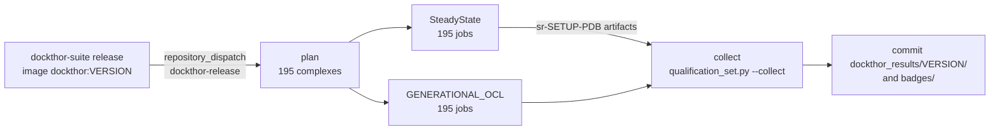

# dockthor_coreset

Redocking qualification set for the [DockThor Suite](https://github.com/gmmsb-lncc/dockthor-suite): 195 protein–ligand complexes, prepared in DockThor's own formats and ready to dock, with the TOML configuration of every complex and the script that runs the whole set and reports the success rates.

It answers one question about a DockThor build or setting: **how often does DockThor put the ligand back into its crystal pose?** Every complex is redocked into its own receptor, and each GA run is a success when its pose is within a given RMSD of the crystal ligand.

- [1. The dataset](#1-the-dataset)
- [2. Repository layout](#2-repository-layout)
- [3. Quick start](#3-quick-start)
- [4. The qualification script](#4-the-qualification-script)
- [5. Output](#5-output)
- [6. Practical notes](#6-practical-notes)
- [7. Automated qualification of every release](#7-automated-qualification-of-every-release)
- [8. References](#8-references)

---

## 1. The dataset

### 1.1 Origin

The complexes are the **core set of PDBbind v2013**, the test set of the CASF-2013 benchmark (Li et al., 2014): 65 protein targets with 3 complexes each, chosen from the PDBbind refined set to cover a wide range of binding affinities with high-quality crystal structures.

Two checks point to v2013 rather than a later release:

- **Size.** The CASF-2013 core set has exactly 195 complexes. The CASF-2016 core set, used with PDBbind v2016 and v2020 (v2020 introduced no new core set), has 285.
- **Dates.** The newest entries here are 2012 depositions (`4g8m`, `4gid`, `4gqq`, `4djv`) and no ID starts with `5`. CASF-2016 includes complexes deposited from 2013 to 2015.

> In this repository the set is also called *vcoreset*. The PDBbind/CASF files were converted to DockThor topologies; the structures are not modified otherwise.

### 1.2 Contents

| | Count | Notes |
|---|---|---|
| Complexes | 195 | Named by PDB ID (`10gs`, `1a30`, ... `4tmn`) |
| Receptors | 195 | DockThor receptor topology (`.in`, the PDBThorBox format) |
| Ligands | 195 | DockThor ligand topology (`.top`, MMFF94S, the MMFFLigand format); 15 to 140 atoms, median 42 |
| Complexes with cofactors | 70 | 239 cofactor topologies in total, up to 23 for one complex (metal ions, waters, coenzymes) |
| Reference poses | 195 | Crystal ligand pose as SDF |
| TOMLs | 195 | One DockThor configuration per complex (`toml/`) |

### 1.3 Files of one complex

For a complex `<pdb>`:

| File | Contents |
|------|----------|
| `receptor/<pdb>.in` | Receptor topology: one line per atom with index, type, coordinates, bonded neighbors, charge, atom/residue name, chain |
| `ligand/<pdb>_ligand.top` | Ligand topology in the **crystal pose**: `$TOTAL_ATOMS` (element, index, MMFF type, charge, x y z, atomic number per atom), `$CON` (bonds), `$SELECTED_TORSIONS` (rotatable bonds) and `$NONBONDED_INTERACTIONS` |
| `cofactor/<pdb>/<pdb>_cofactor-NN.top` | Optional: one topology per cofactor (same format as the ligand), with the matching `.pdb` |
| `config/<pdb>.grid_center.txt` | Center of the docking box, `x y z` in Å |
| `config/<pdb>.grid_size.txt` | Edge of the box, `x y z` in Å; every box is a cube, 11.0 to 26.6 Å (median 16.8) |
| `config/<pdb>.rstep.txt` | Grid step in Å: 0.25 for 186 complexes; for the 9 largest boxes it is raised (up to 0.2987, `3ag9`) to keep 89 intervals per edge, under DockThor's 1,000,000 grid points |
| `reference/<pdb>_ligand.sdf` | Crystal ligand pose (converted with Open Babel), for external RMSD checks |
| `toml/<pdb>.toml` | DockThor configuration of the complex (§1.4) |

A few extra files are kept for reference: `ligand/<pdb>_ligand.top_diedral.inf` (rotatable dihedrals written by the ligand preparation, for `10gs`, `1n1m`, `4dew`, `4tmn`) and `reference/10gs_ligand.top` / `10gs_ligand_with_H.pdb`. DockThor does not read them.

**The reference of the success rate is the ligand topology itself.** DockThor measures the RMSD of each docked pose against the coordinates of the input `.top`, which are the crystal pose. The SDFs in `reference/` hold the same heavy-atom positions (checked for all 195 complexes) and are there for tools outside DockThor (`obrms`, RDKit).

### 1.4 The TOMLs

Each `toml/<pdb>.toml` holds the inputs and the box of one complex, nothing about the docking itself:

```toml
## DockThor qualification set: 1f8b

output-dir="vcoreset_run"
ligand="ligand/1f8b_ligand.top"
receptor="receptor/1f8b.in"
cofactors-path="cofactor/1f8b"          # only for the 70 complexes with cofactors
grid-size=[14.022,14.022,14.022]
grid-center=[26.464,17.2705,62.4755]
grid-rstep=0.25
```

- **Paths are relative to the repository root**, so DockThor must run from there; the script does that (§4.3). To run one TOML by hand: `cd dockthor_coreset; dockthor --config toml/1f8b.toml`.
- **The docking setup is not in the TOMLs.** The evolution type, number of runs, success-rate cutoff and the rest are given when the set is run (`--dockthor-args`), so the same TOMLs serve every setup.
- `output-dir` is `vcoreset_run`; the script's `-o` overrides it.

---

## 2. Repository layout

```
dockthor_coreset/
├── README.md
├── scripts/
│   ├── qualification_set.py   generate and run the TOMLs, collect the success rates
│   └── ci/                    dock.sh (one complex in the release image), badge.py (§7)
├── .github/workflows/         qualification.yml + dock-setup.yml: the release qualification (§7)
├── dockthor_results/          <version>/<setup>_qualification_summary.csv and _success_rate.txt; badges/ (§7)
├── toml/                      195 TOMLs, one per complex
├── receptor/                  <pdb>.in
├── ligand/                    <pdb>_ligand.top
├── cofactor/                  <pdb>/<pdb>_cofactor-NN.{top,pdb}   (70 complexes)
├── config/                    <pdb>.grid_center.txt, <pdb>.grid_size.txt, <pdb>.rstep.txt
└── reference/                 <pdb>_ligand.sdf
```

Results are written inside the repository, one directory per setup (`steadystate/`, `generational_ocl/`, ...); they are untracked files, not part of the dataset. Only the summaries of each DockThor version are kept, in `dockthor_results/<version>/` (§7).

---

## 3. Quick start

Requirements: Python 3.11+ (standard library only), git, and a DockThor build from [dockthor-suite](https://github.com/gmmsb-lncc/dockthor-suite) (its `README.md` explains the build; `build/bin/dockthor` for the CPU, `build_ocl/bin/dockthor` for OpenCL). The repository is public; DockThor Suite is private.

```fish
git clone https://github.com/gmmsb-lncc/dockthor_coreset.git
cd dockthor_coreset
set DOCKTHOR ~/dockthor-suite        # your dockthor-suite checkout (bash: DOCKTHOR=~/dockthor-suite)
```

**SteadyState on the CPU, MPI.** 24 GA runs per complex over 24 MPI processes (one run each), top-10 report and per-run success rates up to 3 Å:

```fish
python3 scripts/qualification_set.py --config-dir toml -o steadystate \
    --dockthor-path $DOCKTHOR/build/bin/dockthor --mpi --np 24 --skip-done \
    --dockthor-args='--ga-evolution-type STEADYSTATE --ga-nrun 24 --success-rate --success-rate-by-run 3'
```

**GENERATIONAL_OCL on the GPU.** OpenCL build, one process (the GPU packs the 24 runs, so no `--mpi`):

```fish
python3 scripts/qualification_set.py --config-dir toml -o generational_ocl \
    --dockthor-path $DOCKTHOR/build_ocl/bin/dockthor --skip-done \
    --dockthor-args='--ga-evolution-type GENERATIONAL_OCL --ga-nrun 24 --success-rate --success-rate-by-run 3'
```

Each prints one line per complex and ends with the paths of the summary and the success rates:

```
Dataset root (from the TOMLs): /home/user/dockthor_coreset
[1/195] 10gs: mpirun -n 24 .../dockthor --config .../toml/10gs.toml --output-dir steadystate --ga-evolution-type STEADYSTATE --ga-nrun 24 --success-rate --success-rate-by-run 3
    ok in <t>s, log: .../steadystate/10gs/10gs_run.log
...
Ran 195 system(s) in <t>s, 0 failed.
Summary: /home/user/dockthor_coreset/steadystate/qualification_summary.csv (195 complex(es) with a _success_rate.csv)
Success rates: /home/user/dockthor_coreset/steadystate/success_rate.txt
```

`steadystate/qualification_summary.csv` then holds the top-N report of every complex (§5.3), and `steadystate/success_rate.txt` the success rate of the whole set for every topK and RMSD cutoff (§5.4). If the run stops, the same command resumes it: `--skip-done` skips the finished complexes.

---

## 4. The qualification script

`scripts/qualification_set.py` does three things, in any combination:

1. **Generate** a TOML per complex from `config/`, `ligand/`, `receptor/` and `cofactor/` (`--generate`).
2. **Run** DockThor on a folder of TOMLs, saving each complex's console output (`--dockthor-path`).
3. **Summarize** the execution time and success rates of every complex run (automatic after 2; alone, from reports gathered elsewhere, with `--collect`).

The dataset can be this repository, any directory with the same layout, or a git repository the script clones (`--git-url`).

### 4.1 Workflows

**A. Run the committed TOMLs** (the usual case, §3). `--config-dir toml` takes every `toml/<pdb>.toml`:

```fish
python3 scripts/qualification_set.py --config-dir toml -o steadystate --dockthor-path $DOCKTHOR/build/bin/dockthor \
    --mpi --np 24 --dockthor-args='--ga-nrun 24 --success-rate --success-rate-by-run 3'
```

**B. A subset.** `--systems` restricts any workflow to some complexes, for a quick check of a build:

```fish
python3 scripts/qualification_set.py --config-dir toml --systems 1bcu 10gs 1f8b -o check \
    --dockthor-path $DOCKTHOR/build/bin/dockthor --mpi --np 4 --dockthor-args='--ga-nrun 4 --success-rate --success-rate-by-run 2'
```

**C. Generate TOMLs with the setup inside them.** `--generate` writes new TOMLs, `--set` adds options to all of them, and `--output-toml-path` keeps them apart from `toml/`. The setup is then recorded with the TOMLs, and `--dockthor-args` is not needed:

```fish
python3 scripts/qualification_set.py --generate -o generational_ocl --output-toml-path toml_generational_ocl \
    --set 'ga-evolution-type="GENERATIONAL_OCL"' --set ga-nrun=24 --set success-rate=true --set success-rate-by-run=3.0 \
    --dockthor-path $DOCKTHOR/build_ocl/bin/dockthor --skip-done
```

Without `--output-toml-path` the TOMLs are written to the dataset root; existing ones are kept unless `--overwrite` is given.

**D. Straight from GitHub.** `--git-url` clones the set (into `./dockthor_coreset` by default; an existing clone there is reused) and runs any of the above on the clone; `--git-ref` pins a branch, tag or commit:

```fish
python3 dockthor_coreset/scripts/qualification_set.py --git-url git@github.com:gmmsb-lncc/dockthor_coreset.git \
    --git-ref main --config-dir toml -o steadystate --dockthor-path $DOCKTHOR/build/bin/dockthor --mpi --np 24 \
    --dockthor-args='--ga-nrun 24 --success-rate --success-rate-by-run 3'
```

The script prints the checked-out commit (`Dataset commit: <sha>`), which ties the results to an exact version of the set.

**E. Another dataset.** Any directory with `config/`, `ligand/`, `receptor/` (and optionally `cofactor/`) laid out as in §1.3 works; pass it as the first argument:

```fish
python3 scripts/qualification_set.py ~/my_set --generate -o results --set ga-nrun=10 \
    --dockthor-path $DOCKTHOR/build/bin/dockthor
```

**F. Merge reports docked elsewhere.** `--collect DIR` builds `qualification_summary.csv` and `success_rate.txt` in one shot from every `<ligand>_docked_success_rate.csv` under `DIR`, flat or in `<pdb>/` folders: the reports of parallel jobs (the release qualification, §7), of several machines, or of a set split by `--systems`. `--config-dir` counts the complexes against its TOMLs and lists the missing ones:

```fish
python3 scripts/qualification_set.py --collect gathered_reports --config-dir toml
# Collected 193 of 195 complex(es) from .../gathered_reports
# [warn] 2 complex(es) without results: 10gs 1bcu
```

### 4.2 Options

Values that start with `-` must use the `=` form: `--dockthor-args='--seed 7'` works, `--dockthor-args '--seed 7'` does not.

**Dataset**

| Option | Default | Description |
|--------|---------|-------------|
| `dataset` (positional) | this repository | Root of the set. Omit it to use the repository holding the script, with `--git-url`, or with `--config-dir` (the root is then inferred from the TOMLs, §4.3) |
| `--systems PDB ...` | all | Only these complexes. Without it: every TOML of `--config-dir`, or every complex of `config/` |
| `--git-url URL` | — | Clone the set from a git repository (HTTPS, SSH or a local path) instead of giving `dataset` |
| `--git-ref REF` | default branch | Branch, tag or commit to check out. Branches and tags are cloned shallow (`--depth 1`); a commit needs a full clone, done automatically |
| `--git-subdir PATH` | repository root | Set root inside the cloned repository, when the set is in a subfolder |
| `--clone-dir DIR` | `./<repo name>` | Where to clone. An existing clone there is reused as is; a non-empty folder that is not a clone stops the script |
| `--git-update` | off | Fetch `--git-ref` (or the remote default branch) into an existing clone and check it out before running |

**Generation**

| Option | Default | Description |
|--------|---------|-------------|
| `--generate` | off | Write `<pdb>.toml` for every selected complex. Requires `-o` and a dataset with `config/` |
| `-o, --output-dir DIR` | TOML's `output-dir` | With `--generate`, the `output-dir` written into the TOMLs. With `--dockthor-path`, also passed to DockThor as `--output-dir`, overriding the TOMLs, so the same TOMLs can be run into one directory per setup. A relative path is relative to the dataset root |
| `--output-toml-path DIR` | dataset root | Where `--generate` writes the TOMLs and where `--dockthor-path` reads them (when `--config-dir` is not given). Relative to the current directory. Input paths inside the TOMLs stay relative to the dataset root |
| `--set KEY=VALUE` | — | Any DockThor option, written into every generated TOML. `VALUE` is a TOML literal: numbers and booleans as is (`--set ga-nrun=24`, `--set symmetric-RMSD=true`), strings quoted (`--set 'ga-evolution-type="STEADYSTATE"'`). Repeatable |
| `--no-cofactors` | off | Leave `cofactors-path` out of the generated TOMLs, to dock without cofactors |
| `--overwrite` | off | Replace existing TOMLs (otherwise they are kept and reported as skipped) |

**Execution**

| Option | Default | Description |
|--------|---------|-------------|
| `--dockthor-path DOCKTHOR` | — | The `dockthor` binary. Runs every selected TOML, one complex after the other |
| `--config-dir DIR` | — | Run the TOMLs already in `DIR` instead of generated ones. Alone, `DIR` is relative to the current directory; with `dataset` or `--git-url`, relative to the dataset root |
| `--mpi` | off | Launch DockThor with `mpirun` |
| `--np N` | 4 | MPI processes per complex. DockThor spreads the `ga-nrun` runs over them, so `--np` equal to `ga-nrun` runs them all at once |
| `--mpirun CMD` | `mpirun` | MPI launcher, e.g. `srun` on a SLURM cluster |
| `--mpi-args=ARGS` | — | Extra launcher arguments, e.g. `--mpi-args='--oversubscribe --bind-to none'` |
| `--dockthor-args=ARGS` | — | Extra DockThor command-line options for every complex; they take precedence over the TOMLs |
| `--summary-csv FILE` | §5.3 | Path of the summary CSV; `success_rate.txt` goes next to it |
| `--rmsd-cutoff RMSD` | §5.4 | Largest cutoff of `success_rate.txt`: 0.5, 1.0, ... up to `RMSD` (rounded up to 0.5); default 2.0 |
| `--generate-summary CSV` | — | Only write `success_rate.txt`, in the current directory, from an existing `qualification_summary.csv` (§5.4); runs alone, nothing is generated or docked |
| `--collect DIR` | — | Only consolidate: write `qualification_summary.csv` (or `--summary-csv`) and `success_rate.txt` from every `<ligand>_docked_success_rate.csv` under `DIR`, flat or in `<pdb>/` folders (§4.1 F). With `--config-dir`, the complexes are counted against its TOMLs and the missing ones listed. Runs alone (with `--config-dir`, `--summary-csv`, `--rmsd-cutoff`), nothing is generated or docked |
| `--skip-done` | off | Skip complexes that already have a `*_docked.csv` in `<output-dir>/<pdb>/`: rerun the same command to resume |
| `--stop-on-error` | off | Stop at the first complex whose DockThor call fails (default: report it and go on) |
| `--dry-run` | off | Print the DockThor commands without running them |
| `-v, --verbose` | off | Also print DockThor's output to the terminal (it is always saved to the run log) |

The exit status is non-zero when any complex fails or a TOML cannot be generated.

**Useful DockThor options for `--dockthor-args` or `--set`** (the full list is in the DockThor manual, `doc/MANUAL_dmrts.md` §6, or `dockthor --help`):

| Option | Meaning |
|--------|---------|
| `--ga-evolution-type` | `STEADYSTATE` (CPU, default) or `GENERATIONAL_OCL` (GPU, OpenCL build) |
| `--ga-nrun N` | Independent GA runs per complex: the denominator of the success rate. 24 runs give 4.2% steps |
| `--success-rate` | Top-N report: energy and RMSD of the lowest-RMSD pose among the top 1..N leaders of all runs. **Always added by the script**, since the summary and `success_rate.txt` are built from it |
| `--success-rate-top N` | N of the top-N report (default 10); requires `--success-rate` |
| `--success-rate-by-run R` | Per-run success rates at 0.5, 1.0, ... up to `R` Å (rounded up to 0.5); also writes every run's leaders (`--log-every-run`). Kept in each complex's directory, not in the summary |
| `--success-rate-RMSD` | Deprecated: DockThor stops with an error |
| `--symmetric-RMSD` | Symmetry-aware RMSD to the crystal ligand (`RMSD_ref`, so the success rate); the clustering keeps the plain heavy-atom RMSD. More accurate for symmetric ligands (§6) |
| `--symmetric-RMSD-clustering` | Deprecated (DockThor warns): the former `--symmetric-RMSD`, symmetry-aware RMSD for the clustering too; much slower (§6) |
| `--seed N` | RNG seed, for repeating a qualification exactly |
| `--ga-evaluations N`, `--ga-init-evaluations N` | Length of the evolution (lower for quick checks) |
| `--ocl-device-type`, `--ocl-platform-name` | GPU selection for `GENERATIONAL_OCL`; `dockthor --ocl-display-devices` lists the devices |

### 4.3 How paths are resolved

The input paths in the TOMLs (`ligand/...`, `receptor/...`, `cofactor/...`) are relative to the **dataset root**, and the script always runs DockThor with the dataset root as working directory, passing each TOML by its absolute path. The dataset root is:

| Given | Dataset root | `--config-dir DIR` relative to |
|-------|--------------|-----------------------------|
| nothing (only `--dockthor-path`, `--generate`, ...) | the repository holding the script | the dataset root |
| `dataset` | `dataset` | the dataset root |
| `--git-url` | the clone (or `--git-subdir` in it) | the dataset root |
| `--config-dir DIR` only | inferred: `DIR` or the first parent of it where the `ligand` and `receptor` of a TOML exist | the current directory |

With `--config-dir` alone the script prints the root it inferred (`Dataset root (from the TOMLs): ...`) and stops if no such folder exists. Run the examples of this README from the repository root, or give `--config-dir` as an absolute path.

The output directory (`-o` or the TOML's `output-dir`) is relative to the dataset root too: `-o steadystate` writes to `dockthor_coreset/steadystate/`.

---

## 5. Output

### 5.1 Directory tree

```
<output-dir>/
├── qualification_summary.csv                    top-N report of every complex (§5.3)
├── success_rate.txt                             success rate of the set per topK/overall and cutoff (§5.4)
├── 10gs/
│   ├── 10gs_run.log                             console output of the DockThor call
│   ├── 10gs_ligand_docked.csv / .mol2           cluster leaders of all runs, best energy first
│   ├── 10gs_ligand_docked_success_rate.csv      top-N report, one row (--success-rate, always added by the script)
│   ├── 10gs_ligand_docked_success_rate_by_run.csv   per-run rates, one line per criterion and cutoff (with --success-rate-by-run)
│   └── 10gs_ligand_docked_run_<N>.csv / .mol2   leaders of run N (with --success-rate-by-run or --log-every-run)
├── 1a30/
...
```

Each complex directory is named after its receptor file (the PDB ID). The DockThor files are described in the DockThor manual (`doc/MANUAL_dmrts.md` §10).

### 5.2 Run log

`<output-dir>/<pdb>/<pdb>_run.log` is the console output of the DockThor call: the command line, then stdout and stderr, without the terminal colors. It holds the grid, the evolution progress, the top-N summary and the per-run success-rate table:

```
[DOCKTHOR] Success rate (%) over 24 runs, RMSD <= cutoff.
           |------->   <=RMSD  % by energy    % by RMSD
           |------->     0.50        25.00        25.00
           |------->     1.00        33.33        41.67
           ...
```

### 5.3 Summary CSV

`qualification_summary.csv` is the consolidation of every `<pdb>/<ligand>_docked_success_rate.csv`, the one-row top-N report DockThor writes with `--success-rate`: one row per complex, with DockThor's own columns.

```
complex,execution_time(s),num_top,overall_min_RMSD_E,overall_min_RMSD,top1_E,top1_RMSD,top2_E,top2_RMSD,...,top10_E,top10_RMSD
1bcu,2.61,100,-4.174,0.467,-4.974,1.519,-4.174,0.467,...,-4.174,0.467
1a30,3.70,100,65.495,1.880,48.371,3.471,55.014,2.435,...,65.495,1.880
```

| Column | Unit | Description |
|--------|------|-------------|
| `complex` | — | PDB ID (DockThor's receptor name) |
| `execution_time(s)` | s | DockThor's wall time up to the report (grids, docking, clustering) |
| `num_top` | — | Number of leaders of the all-runs clustering |
| `overall_min_RMSD_E`, `overall_min_RMSD` | kcal/mol, Å | Energy and RMSD of the leader with the lowest RMSD over all the leaders of the all-runs clustering, not only the top N. Empty for results of DockThor 2.1.0 and earlier |
| `topK_E`, `topK_RMSD` | kcal/mol, Å | Energy and RMSD of the lowest-RMSD pose among the K best-ranked leaders, K = 1 ... N (`--success-rate-top`, 10 by default) |

The script rewrites it, and `success_rate.txt`, after every complex, so an interrupted set keeps what is done. Complexes skipped by `--skip-done` are included from their existing files, so a resumed set still gets the whole consolidation. The script always passes `--success-rate` to DockThor (it is added when `--dockthor-args` lacks it), so every docking that succeeds has its row; a complex that failed has none. When complexes use different N, the columns are the union and missing values are empty. The file goes to the common output directory (`<output-dir>/qualification_summary.csv`), or next to the TOMLs when the complexes write to different directories; `--summary-csv FILE` sets it explicitly.

### 5.4 What the success rates mean

DockThor computes the reports at the end of each docking; the full definition is in the DockThor manual, `doc/MANUAL_dmrts.md` §10.5.

**Top-N (`topK_*`).** The leaders of the clustering of all runs (the poses of `_docked.csv`) are sorted by energy; `topK` is the pose with the lowest RMSD to the crystal ligand among the first K. `top1` is DockThor's answer, and the RMSD can only drop as K grows: the K where it first falls below 2 Å is the rank at which the native pose shows up. When there are fewer than N leaders (`num_top` < N), the last `topK` repeat the best of them all.

**Success rate of the set (`success_rate.txt`).** For every cutoff *c* = 0.5, 1.0, ... up to `--rmsd-cutoff` (rounded up to 0.5) and every `topK`, the share of complexes whose `topK_RMSD <= c`, over the complexes with a `_success_rate.csv`. `top1` at 2 Å is the classic redocking success rate; `top10` at 2 Å, how often the native pose is among the 10 best-ranked poses. The first column, `overall`, is the share whose `overall_min_RMSD <= c`: whether the native pose is among the leaders at all, at any rank. With the 3 complexes above (short runs, `--rmsd-cutoff 2.2`):

```
Success rate (%) of the top-N report (DockThor --success-rate), topK_RMSD <= cutoff
overall: overall_min_RMSD <= cutoff (the lowest-RMSD leader of all the leaders)
Complexes with results: 3 of 3

RMSD_cutoff  overall     top1     top2     top3     top4     top5     top6     top7     top8     top9    top10
        0.5    33.33     0.00    33.33    33.33    33.33    33.33    33.33    33.33    33.33    33.33    33.33
          1    33.33     0.00    33.33    33.33    33.33    33.33    33.33    33.33    33.33    33.33    33.33
        1.5    33.33     0.00    33.33    33.33    33.33    33.33    33.33    33.33    33.33    33.33    33.33
          2    66.67    33.33    33.33    33.33    66.67    66.67    66.67    66.67    66.67    66.67    66.67
        2.5   100.00    33.33    66.67    66.67    66.67    66.67    66.67    66.67    66.67    66.67    66.67
```

`Complexes with results` is the denominator; a failed complex is left out of it, so compare it with the number of complexes run. Each column counts only the complexes that have its value: results of DockThor 2.1.0 and earlier have no `overall_min_RMSD`, so they are left out of `overall` (the column is missing when no complex has it).

**From an existing summary (`--generate-summary`).** When a set was run in pieces (an interrupted run finished by hand, or complexes run on different machines) and the `qualification_summary.csv` files were joined into one, rebuild the success rates from it. `success_rate.txt` is written to the current directory, with the cutoffs of `--rmsd-cutoff`; the denominator is the number of complexes in the CSV:

```fish
cd ~/results/steadystate
python3 ~/dockthor_coreset/scripts/qualification_set.py --generate-summary qualification_summary.csv --rmsd-cutoff 2
```

**Per run (`--success-rate-by-run`).** In short, with *N* = `ga-nrun` runs:

1. Each run is clustered on its own, and its leaders are sorted by energy.
2. **By energy:** each run contributes its lowest-energy leader, the pose DockThor would answer with.
3. **By RMSD:** each run contributes its leader closest to the crystal pose, which shows whether the run found the native pose at all.
4. A run succeeds at cutoff `c` when that pose's heavy-atom RMSD to the crystal ligand is `<= c` Å; the rate is `successful runs / N × 100`.

The rate by RMSD is never below the rate by energy; the gap is the share of runs that found the native pose but scored another one better. The usual redocking criterion is **2.0 Å**. The per-run rates stay in each complex's `<ligand>_docked_success_rate_by_run.csv` (`complex,runs,sorting_by,min_Energy,min_RMSD,RMSD_cutoff,%_success`); they are not part of the summary.

---

## 6. Practical notes

- **One output directory per setup.** Give every setup its own `-o` (`steadystate`, `generational_ocl`, `steadystate_sym`, ...). With `--grid-write`, DockThor reuses a grid file already in the output directory after checking only its size, receptor atom count, center and atom types, so a grid left from another build or setting can be loaded silently. Use a fresh directory, or do not pass `--grid-write`.
- **MPI processes.** With `--np` equal to `ga-nrun` all runs evolve at once; with fewer processes each one runs several in turn (`--np 12` with 24 runs takes about twice as long per complex). `GENERATIONAL_OCL` needs a single process: no `--mpi`.
- **Open MPI accelerator conflict.** If `mpirun` fails with a rocm/cuda accelerator error, export `OMPI_MCA_accelerator='^cuda,rocm'` (fish: `set -x OMPI_MCA_accelerator '^cuda,rocm'`) before running.
- **Symmetric RMSD.** `--symmetric-RMSD` gives lower, more correct RMSDs for ligands with symmetric groups (on `10gs`, 0.91 → 0.38 Å for one pose), which raises the rates at tight cutoffs; at 2 Å it rarely changes them. It is computed only between each leader and the crystal ligand, so the leaders are the same as without it. The deprecated `--symmetric-RMSD-clustering` (the former `--symmetric-RMSD`) also uses it in the clustering, which made the clustering of `10gs` take about 6.5 minutes instead of seconds and changes the leaders.
- **Resuming.** `--skip-done` skips complexes with results, so a killed set resumes with the same command; the summary of the new call lists only the complexes it ran. Delete a complex's directory to run it again.
- **Clusters.** Use `--mpirun srun` (and `--mpi-args` for its options) inside a SLURM allocation; the run logs and the summary are written as the set progresses.
- **Checking the RMSDs outside DockThor.** `reference/<pdb>_ligand.sdf` with Open Babel's symmetry-aware `obrms` reproduces DockThor's `--symmetric-RMSD` values: `obrms -f reference/10gs_ligand.sdf steadystate/10gs/10gs_ligand_docked.mol2`.

---

## 7. Automated qualification of every release

Every DockThor Suite release qualifies itself on this set with GitHub Actions. The suite's `release.yml` publishes the private image `ghcr.io/gmmsb-lncc/dockthor:<version>` (with `dockthor-mpi` and `dockthor-ocl`, dockthor-suite `doc/MANUAL.md` §4.6) and then starts `.github/workflows/qualification.yml` here.



### 7.1 Setups

One job per complex and setup (`.github/workflows/dock-setup.yml`, `scripts/ci/dock.sh`), in the release image:

| Setup | Binary | Launch | `--dockthor-args` |
|---|---|---|---|
| `steadystate_symmetric` | `dockthor-mpi` | `--mpi --np 2 --mpi-args=--oversubscribe` | `--ga-evolution-type STEADYSTATE --ga-nrun 24 --success-rate --success-rate-by-run 3 --symmetric-RMSD` |
| `generational_ocl_symmetric` | `dockthor-ocl` | no MPI (one process) | `--ga-evolution-type GENERATIONAL_OCL --ga-nrun 24 --success-rate --success-rate-by-run 3 --symmetric-RMSD` |

The runners have no GPU: `GENERATIONAL_OCL` runs on their CPU through PoCL, so its success rates are comparable with a GPU run and its execution times are not. `--oversubscribe` lets Open MPI start 2 processes when a runner's container shows fewer physical cores.

### 7.2 Results

Each job keeps only its one-row `<pdb>_ligand_docked_success_rate.csv` (artifact `sr-<setup>-<pdb>`, 7 days). The `collect` job gathers them per setup, runs `--collect` (§4.1 F) and commits:

- `dockthor_results/<version>/<setup>_qualification_summary.csv` and `<setup>_success_rate.txt`, as for earlier versions;
- `dockthor_results/badges/<setup>.json`, a [shields.io endpoint](https://shields.io/badges/endpoint-badge) badge with the `overall` success rate at 2 Å (the % of complexes whose lowest-RMSD leader is within 2 Å of the crystal ligand). Shown in a README with:

```markdown


```

A complex whose job failed is missing from the summary and listed in the `collect` job's summary page (`Complexes with results: N of 195`).

### 7.3 Running it by hand

Actions → "Qualification of a DockThor release" → Run workflow, with the image version (`2.1.0`), the setups, optionally a few complexes (`1bcu 10gs`) and a results folder. Manual runs commit only when `commit` is checked, and update the badges only when the results folder is the version itself. A test into `dockthor_results/2.1.0/` would overwrite the reference results: give it another folder (`2.1.0-ci`).

### 7.4 Privacy

This repository and its Actions logs are public; the image is not. The image is pulled with each job's own `GITHUB_TOKEN` (`dockthor_coreset` has read access in the package settings) and is never saved, uploaded or cached. DockThor's console output and the poses stay on the runner; only the success-rate CSVs leave it. The workflows run only on `repository_dispatch` and `workflow_dispatch`, never on pull requests, so forks cannot reach the image.

---

## 8. References

- **CASF-2013 core set:** Li, Y.; Liu, Z.; Li, J.; Han, L.; Liu, J.; Zhao, Z.; Wang, R. Comparative Assessment of Scoring Functions on an Updated Benchmark: 1. Compilation of the Test Set. *J. Chem. Inf. Model.* **2014**, 54, 1700–1716. DOI [10.1021/ci500080q](https://doi.org/10.1021/ci500080q).
- **CASF-2013 evaluation:** Li, Y.; Han, L.; Liu, Z.; Wang, R. Comparative Assessment of Scoring Functions on an Updated Benchmark: 2. Evaluation Methods and General Results. *J. Chem. Inf. Model.* **2014**, 54, 1717–1736. DOI [10.1021/ci500081m](https://doi.org/10.1021/ci500081m).
- **PDBbind:** Wang, R.; Fang, X.; Lu, Y.; Wang, S. The PDBbind Database: Collection of Binding Affinities for Protein–Ligand Complexes with Known Three-Dimensional Structures. *J. Med. Chem.* **2004**, 47, 2977–2980. DOI [10.1021/jm030580l](https://doi.org/10.1021/jm030580l).
- **DockThor:** see the references of the [DockThor Suite](https://github.com/gmmsb-lncc/dockthor-suite) (`doc/MANUAL_dmrts.md` §16).

The PDBbind structures are distributed under the PDBbind terms of use; cite PDBbind and CASF when using this set.
